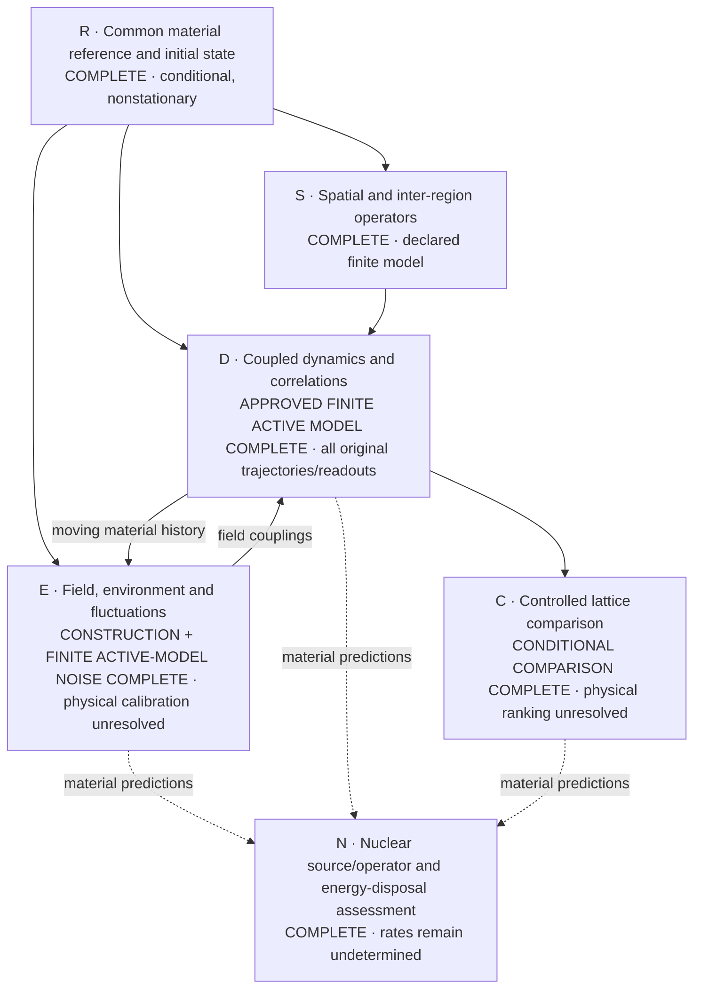
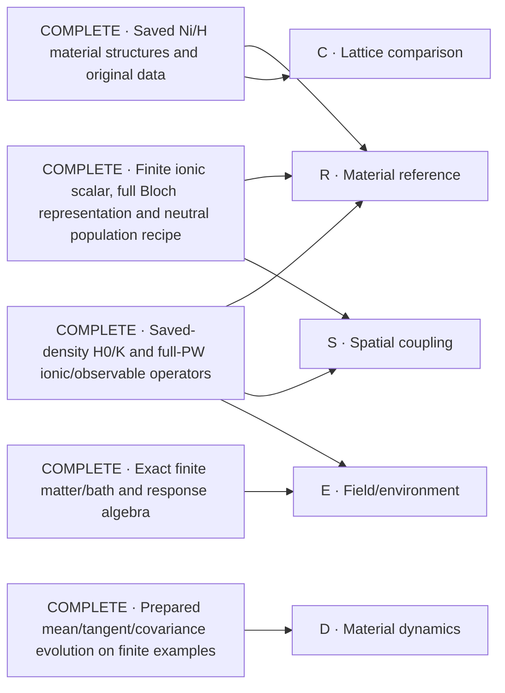

# Ni/H collective-response solution map

The objective is a material-calibrated many-region simulation, a defensible lattice comparison, and an explicit nuclear-transition/energy-disposal construction. This map keeps that whole objective visible. Nodes are scientific outputs, not approval checkpoints. The user's 28 October instruction is to reuse real existing solutions, solve the missing core nodes, and avoid process minutiae. The authoritative scope is [P254](proposal.yaml).

**Current position, 4 November:** the approved finite active-model simulation and its [all-sixteen numerical comparison](attempts/0029/final-four-structure-actual-comparison-admission-001.json) are complete. The [complete complementary scientific review](attempts/0029/complete-active-model-scientific-review-admission-001.json) found no defects at that explicitly conditional scope; it reused existing numerical evidence rather than rerunning production. [Compact scientific observations](attempts/0029/final-saved-result-scientific-summary-001.json) and the [exact lossless publication](attempts/0029/complete-comparison-lossless-publication-001.json) preserve the actual result. The broader physical parent and campaign PR remain open: passive/full-PW noise, material accuracy, physical loss/lifetime and a physical lattice ranking are not established. Numerical completion alone does not authorize terminal campaign closure.

## Core scientific work

Solid arrows identify material inputs needed by a result. Dashed arrows identify future material-prediction inputs, not prerequisites for identifying the nuclear mechanism's missing operator/data. The nuclear source/operator assessment is complete at that exact scope; no other node is marked complete merely because a helper or finite example works.

**Completed finite-model comparison.**

The [complete original publication, lossless gzip](attempts/0029/all-four-structure-four-resolution-actual-comparison-001.json.gz) consumes every original structure at eight/twelve active bands and seven/twenty-seven density families. It reports all saved 0/1/10/30 points, complex spatial correlations, finite-dose energy and canonical controls. The [actual admission](attempts/0029/final-four-structure-actual-comparison-admission-001.json) records successful Native exit, complete numerical coverage, unchanged original result identities, and explicit unsupported isotope/preparation comparisons. No electronic trajectory or preparation was replayed.

The selected same-cell Ni-displacement ordered degree of coherence at 30 inverse Ry, relative to 0, spans these **observed nested-model ranges**:

| Structure | Minimum magnitude | Maximum magnitude |
| --- | ---: | ---: |
| H-loaded Ni31H6 | 0.989656772 | 0.990995860 |
| Dispersed Ni32H6 | 0.990361626 | 0.991950536 |
| Pristine Ni32 | 0.991116571 | 0.992658532 |
| Vacancy Ni31 | 0.990844966 | 0.992309963 |

Only pristine versus H-loaded has disjoint ranges in this selected conditional observable; the other pairs overlap. Each structure retains its own registered preparation. These are neither matched state subtractions nor physical error bars. The saved samples do not determine a continuous-time coherence window, entanglement or a physical lifetime. Raw phases, complex values, variance defects and all spatial cells remain in the publication; the correlations describe the unexcited moving active-Gaussian baseline, not the finite-kicked state or omitted passive/full-PW noise.

**Finite-dose mean response and energy redistribution.**

These direct saved-data rows select the predeclared maximum twelve-band/twenty-seven-family model at 30 inverse Ry; they do not assert representation convergence. The local Ni1/x pulse and baseline subtraction are unchanged. Participation measures displacement weight, not the number of quantum-coherent cells; RMS distance uses periodic cell centres.

| Structure | Ni participation | Ni RMS distance (bohr) | H participation |
| --- | ---: | ---: | ---: |
| H-loaded Ni31H6 | 1.411314 | 5.676079 | 1.080524 |
| Dispersed Ni32H6 | 1.923266 | 8.371266 | 6.111696 |
| Pristine Ni32 | 1.889544 | 8.248076 | Not applicable |
| Vacancy Ni31 | 1.438169 | 5.822710 | Not applicable |

Real parts of the same model's baseline-subtracted scalar components, in Ry:

| Structure | Band | Screening | Interaction | Mechanical | Total |
| --- | ---: | ---: | ---: | ---: | ---: |
| H-loaded Ni31H6 | 3.644314e-08 | 1.540516e-08 | 1.121653e-08 | 9.283470e-06 | 9.346535e-06 |
| Dispersed Ni32H6 | 9.646810e-07 | 1.828831e-07 | 5.767713e-07 | 7.622199e-06 | 9.346535e-06 |
| Pristine Ni32 | 4.841795e-08 | 1.508804e-08 | 1.247584e-08 | 9.270553e-06 | 9.346535e-06 |
| Vacancy Ni31 | 5.123532e-08 | 1.340897e-08 | 1.168799e-08 | 9.270202e-06 | 9.346535e-06 |

The [compact source-bound observations](attempts/0029/final-saved-result-scientific-summary-001.json) retain unrounded values, raw imaginary components, scalar-sum defects, total-energy drift, species-resolved kinetic exchange and boundary-weight diagnostics. This is reversible mean electronic/ionic/Maxwell exchange, not heat, dissipation or an inferred energy current; no missing quantum-covariance energy is assigned as a residual.

**Supported conclusion:** the approved model now supplies actual spatial finite-dose response, energy redistribution and sampled connected correlations for every original candidate and nested representation. In the maximum representation, dispersed Ni32H6 has a larger displayed band-energy change and Ni mean-response extent than H-loaded Ni31H6. That conditional result does not establish a material design advantage. Physical ranking remains unresolved because the original preparations differ, passive/full-PW noise is uncalibrated, the fixed spatial representation has unresolved physical/size errors, and reversible exchange does not determine irreversible material losses. The nuclear source/operator assessment remains separate; no nuclear rate or heat follows.

**Actual endpoint-energy result completed31October.** The [byte-exact eleven-term response-energy report](attempts/0028/saved-energy-positive-complete-result-001.json) consumes the genuine saved `0.001` inverse-Ry mixed endpoint, with all128 original electronic sources and no new trajectory or initialization. The [actual terminal and CPU-release evidence](attempts/0028/saved-energy-positive-complete-intake-001.json) records successful exit, no remaining owned workers and4024 cumulative actions within the4096 ceiling and original-clock28800-second budget. This is a mixed response-energy coefficient, not finite-dose energy, heat or a conservation certificate. Those CPUs subsequently completed the original covariance and are now released; neither result needs a propagation replay.

**Actual selected-Γ force readout completed2November.** The [executed material publications and original-input provenance](attempts/0028/independent-coherent-readout-summary-001.json) consume the two saved original-time duals for the declared unit Ni1/x cell0 ionic-momentum-only kick and independent H37/x force probe. These are complex Fourier components, not a real-space force at one cell. The existing canonical contraction is unchanged; no electronic trajectory was replayed.

| Time (inverse Ry) | Re force component (Ry/bohr) | Im force component (Ry/bohr) |
| --- | --- | --- |
| 0.0005 | -1.04358415e-09 | 5.09623567e-26 |
| 0.001 | -2.08713185e-09 | 1.01896444e-25 |

Displayed coefficients are not precision certificates. Imaginary parts remain visible. These force-response samples do not establish spatial extent, a coherence window, finite-dose response or heat; the independently completed covariance below is a different observable.

**Actual selected-q force covariance complete.** The [byte-identical scientific terminal and publication](attempts/0028/source-local-material-covariance-complete-intake-001.json) retain the genuine cumulative-continuation schema and original owner/preparation/full-PW/fixed-D authority. The existing consumer verifies all128 ordered source payloads and the independently retained ionic/field origins. These are connected H37/x q0 force covariances on the unexcited moving reference, at `t=0.0005`, `s=0.001` inverse Ry.

| Published quantity | Real, (Ry/bohr)² | Imaginary, (Ry/bohr)² |
| --- | --- | --- |
| Ordered AB total | 9.60376688e+00 | 9.35517390e-02 |
| Ordered BA total | 9.60376688e+00 | -9.35517390e-02 |
| Symmetrized | 9.60376688e+00 | -1.58484337e-14 |
| Commutator | 3.55271368e-15 | 1.87103478e-01 |

The original unrounded complex values and frame-compatibility diagnostics remain in the publication; no clipping or symmetrization repair. This is one external-q/probe/time pair, not64-q spatial coverage, a field-noise spectrum, irreversible loss, heat, material accuracy or a lattice ranking.

**Actual saved coupled atom/species response completed3November.** The [consumed37-atom publication and matched-control intake](attempts/0028/saved-coupled-atom-control-complete-intake-001.json) resolve the original Ni1/x unit-kick Γ response at0.001 inverse Ry into original Ni/H coordinates. Plus, minus and mixed displacement, canonical momentum and mechanical velocity remain complex and independent; the unexcited mean/drift are separate. The minimally coupled kinetic mixed-response change from the original initial state is:

| Species | Re change of kinetic mixed component (Ry) | Im change of kinetic mixed component (Ry) |
| --- | --- | --- |
| Ni | -3.43291596e-15 | -3.30859300e-32 |
| H | 3.96399973e-27 | 5.09703281e-44 |

These are computed Γ component-response coefficients, not finite-dose energy transfer, heat or precision certificates. The endpoint atom sum agrees with the genuine completed kinetic scalar within the reported reduction-roundoff comparison. A new [same-time/same-seed frozen-electron counterfactual](attempts/0028/saved-canonical-matched-comparison-002.json) is also consumed; each model's baseline remains separate. Raw differences do not establish a resolved electronic effect, stationary screening correction, local spreading or a lattice ranking. No electronic trajectory or H0 action was needed for these outputs.

**Complete initial spatial response, four original structures.** The [actual full-grid initial-force jets](attempts/0028/four-original-initial-force-response-intake-001.json) cover all64 original wavevectors/cells and every original atom for loaded, dispersed, pristine and vacancy scalars under the same Ni1/x unit canonical kick. The [source-bound symbolic/full moving-coupled RHS oracle](attempts/0028/exact-initial-force-response-oracle-002.json) establishes the exact initial derivative without a stationary-reference assumption. This is not positive-time full-grid propagation or a coherence window. The [observed Γ differences from the initial linear term](attempts/0028/initial-force-versus-propagated-gamma-001.json) are retained as differences, not rigorous remainder/error bounds.

**Direct electronic/ionic/field force origins, no new contractions.** The [actual all37-atom plus/minus/mixed force publication](attempts/0028/saved-direct-force-origins-complete-intake-001.json) consumes the genuine saved global electronic gradients and physical canonical p-RHS at0.001 inverse Ry. Individual source payloads were deliberately retired against that exact prepared-context barrier; surviving receipts and global arrays authenticate, and no missing source was reconstructed or replaced by zero. For the original Ni1/x seed and H37/x Γ force probe:

| Direct force origin | Real Fourier force (Ry/bohr) | Imaginary Fourier force (Ry/bohr) |
| --- | --- | --- |
| Electronic | 4.86101422e-14 | -7.11868081e-27 |
| Ionic | -2.08718046e-09 | 1.01924853e-25 |
| Field | 1.15675732e-25 | 2.57699092e-32 |

The electronic term is the direct retained gradient, never total force minus other terms. The reconstructed totals reproduce the saved physical p-RHS; independent original-dual differences and same-time/seed frozen-electron comparisons remain visible in the publication. These are conditional model coefficients, not a resolved material screening/enhancement effect, accuracy certificate, finite-dose force, heat or spatial coherence.

| Node | Required scientific output | Current work |
| --- | --- | --- |
| R | A declared full-material state with consistent density, force and curvature accounting; reference drift and approximation error remain visible. | **Complete conditional reference and initial state:** all20 sources/all128 slots, weighted density/force/kernel shift, conditional curvature, all raw electronic frames and explicit zero ionic means. The64-cell ionic trap-vacuum and conditional q0 field Gaussian are calculated. Nonzero initial force, declared geometric transport and finite ionic Taylor coefficients remain explicit; this is not equilibrium or physical convergence. Evolving the reference drift belongs to D. [Reference](attempts/0028/full-common-reference-004/summary.json), [electronic state](attempts/0028/full-state-initialization-intake-001.json), [ionic preparation](attempts/0028/ionic-gaussian-material-002/result.json), [field state/scalar](attempts/0028/joint-field-aggregate-001/result.json). |
| S | Material-derived finite-wavevector and inter-region operators, with the actual ionic/electronic spatial coverage. | **Complete operator construction at the declared finite-model scope:** full frozen4×4×4 q-grid/force lattice and conditional-state conversion; physical-UPF same-sector and rectangular finite-q operators use the actual full PW spaces. Independent equations and actual saved/complement probes pass; the scalar handoff includes the fixed curvature correction exactly once. This is not screened phonon response, a convergence claim or permission to reuse future trajectories by symmetry. [Physical material operators and scalar handoff](attempts/0028/physical-spatial-material-001/result.json), [independent oracle](attempts/0028/physical-spatial-oracle-003.json), [common lattice](attempts/0028/full-common-reference-004/summary.json). |
| E | A physical material/field/environment construction with its corresponding fluctuations and energy transfer. | **Construction and declared noise outputs complete:** physical-UPF current/contact/mixed coefficients, original canonical ionic/field coupling, conditional Gamma preparation, Cartesian field observables, genuine full128-source H37/x Gamma force pair, and the approved active-Gaussian spatial/time readouts. [Original full-PW pair](attempts/0028/source-local-material-covariance-complete-intake-001.json), [actual active-model comparison](attempts/0029/final-four-structure-actual-comparison-admission-001.json). Passive/full-PW noise calibration and irreversible physical loss remain unresolved; the reduced force-noise comparison does not reproduce the retained full-PW covariance. |
| D | Actual material trajectories after local excitation, baseline motion, connected space/time correlations and energy accounting. | **Approved finite active-model simulation complete:** every original structure and nested representation has baseline-plus-finite-dose response and connected spatial/time readouts at all original times. Actual mean scalar components, species kinetic exchange, spatial participation/extent and raw diagnostics are consumed without replay. [All original completions](attempts/0029/four-original-structures-finite-dynamics-complete-001.json), [complete scientific observations](attempts/0029/final-saved-result-scientific-summary-001.json). This is not full-PW convergence, finite-kicked-state covariance, a physical lifetime or heat. |
| C | Matched lattice comparisons whose conclusions survive relevant numerical, size and physical controls. | **Conditional numerical comparison complete; physical ranking unresolved:** all original nested models, actual matched canonical/clamped preparations, saved isotope counterfactuals and observed sensitivities are consumed. Unsupported isotope/preparation matches remain explicit rather than silently subtracted. Original equal-dose and early full-PW controls retain their exact scopes. [Complete lossless publication](attempts/0029/all-four-structure-four-resolution-actual-comparison-001.json.gz), [actual admission](attempts/0029/final-four-structure-actual-comparison-admission-001.json). Different preparations, omitted passive noise and unresolved physical/size errors prevent a material ranking or loss prediction. |
| N | A sourced transition/operator assessment and medium map with explicit energy/product disposal and exact missing physical inputs. | **Source/operator assessment complete:** DPV1988, BDP1989 and Kim2011 are mapped to their actual operators and physical prerequisites. Evaluated reaction/product energies, ordinary measured channels and conditional NIST transport are consumed. The actual sensitive SymPy witness proves why material coherence alone cannot determine a nuclear rate. Pair preparation, normalized channel/receiver amplitudes, nuclear-frequency matching, exclusive spectra and finite-specimen transport remain missing physical inputs—not invented rates or a universal no-go. [Complete assessment](attempts/0028/nuclear-medium-assessment.md), [executed consumer/oracle](attempts/0028/nuclear-medium-assessment-001.json). |

The integrated result receives one complete scientific review and its necessary corrections, then the required distinct-authorized merge. These are delivery work, not extra scientific nodes.

## What is complete and reusable

These are completed constructions at their recorded scopes. The entries below identify existing solutions only; they do not imply an existing solution for every open node.

| Existing solution | Reuse | Evidence and scope |
| --- | --- | --- |
| Saved full-host material structures and original electronic files | Material geometry, species, masses and source wavefunctions; matched structural controls. | [Primary-material completion](https://github.com/vantasnerdan/substrate-framework/issues/225#issuecomment-6414684011). Declared coarse stationary inputs are complete; numerical calibration and coupled spectra are not thereby complete. |
| Matched saved-density Hamiltonian/kernel and full-PW force/number factors | Existing `qe_material_hamiltonian.py` and material factor/readback APIs, rather than another DFT reconstruction. | [A25 admission](attempts/0025/review-admission.json), with actual-material output and separate readback. This does not select a physical equilibrium state. |
| Full-coordinate material maps and prepared-state evolution | Existing `PreparedReference`, `PreparedFactorDynamics`, prepared covariance and observable consumers. | [A26 admission](attempts/0026/review-admission.json). Actual material maps are complete; finite-time prepared evolution was exercised on a synthetic system, not a completed material trajectory. |
| Finite ionic scalar/common force reference; lazy full Bloch grid; conditional neutral preparation | Existing ionic, `qe_bloch_*`, `material_preparation_*` and authenticated saved-output consumers. | [A27 admission](attempts/0027/review-admission.json). Full electronic representation and population ledger are complete; actual raw preparation/readout covers one selected Gamma sector. Finite ionic sums are not a convergence certificate. |
| Exact matter/field/bath elimination and finite-fermion response identities | Existing `material_matter_field.py` and the admitted finite-fermion constructions. | [A1](attempts/0001/receipt.json) and [A7](attempts/0007/receipt.json), also identified in [the source inventory](proposal.yaml). These supply algebra, not Ni-specific loss parameters or a nuclear mechanism. |
| Evaluated isotope and product-energy data | A source-backed Ni/H reaction ledger with explicit daughter products, decay topology and atomic-reference energy accounting. | [Actual ledger](attempts/0028/nuclear-product-energy-ledger.json), [AME2020/NUBASE2020 provenance](attempts/0028/nuclear-source-acquisition.json), and [source/physical scope](attempts/0028/nuclear-source-registration.json). This calculates available reaction energy, not fusion probability or deposited heat. |
| Actual spatial force lattice and physical finite-q electronic bridge | Complete periodic force-lattice representation and physical-UPF rectangular ionic/density/kernel actions; share physical factors rather than append a second zero-field correction. | [Frozen material grid](attempts/0028/ionic-q-grid-material-001/result.json), [physical material actions/scalar join](attempts/0028/physical-spatial-material-001/result.json), and [conditional-state conversion](attempts/0028/full-common-reference-004/summary.json). Not screened modes or an ASR-repaired matrix. |
| Complete conditional material reference and raw initial state | Reuse all20 source checkpoints, complete128-slot reductions and the already instantiated raw frames/fixed D; no refilling or repeated Gram calculation. | [Full reference](attempts/0028/full-common-reference-004/summary.json), [full initial boundary intake](attempts/0028/full-state-initialization-intake-001.json). Actual force is nonzero; no equilibrium or physical temperature inferred. |
| Saved-primary case inputs, complete matched coefficients and source-exact quantum initial states | Reuse `MatchedJointCase.make_mean`, `make_history` and `bind_response`, plus the original ledgers and authenticated saved-state consumers; do not rebuild DFT backgrounds, refill states or repeat completed contractions. | All four complete sums and actual128-slot readbacks are linked under C. The shared physical-onsite scalar uses zero additional spatial correction. This is reusable input/state construction, not comparative response or convergence. |
| Physical field derivatives and initial quantum force fluctuations | Unanchored physical-UPF current/contact, ordered quasifree kernels and periodic q0 Maxwell normalization; existing stored noise is consumed without new force actions. | [Physical field material](attempts/0028/field-derivatives-material-001/field-derivatives.json), [actual environment consumer](attempts/0028/physical-environment-material-001/summary.json), [independent kernel/field oracle](attempts/0028/physical-environment-oracle-001.json). Original cubic-contact adverse refinement remains retained; finite internal memory is not irreversible loss. |
| Measured ordinary nuclear channels | Primary measured cross sections and conditional capture/second-proton/decay bookkeeping, with source energy domains and upper limits retained. | [Actual table consumer](attempts/0028/measured-nuclear-channels-001.json), [independent oracle](attempts/0028/measured-nuclear-oracle-001.json). The printed Simon Ni58 Q discrepancy is documented against the original page and evaluated masses; no measured table is silently altered. |
| Conditional full ionic quantum preparation | Independent positive clamped-site trap vacua, exact ordered/symmetric covariance and64-cell real/q-space replication; explicit electronic/ionic tensor product. | [Actual material covariance](attempts/0028/ionic-gaussian-material-002/result.json), [independent oscillator/Fock/Fourier and scaling oracle](attempts/0028/ionic-gaussian-oracle-002.json). Sudden-release hypothesis, not measured cooling or equilibrium. Dynamical curvature is unchanged. |
| Original product-transport data and conditional energy ledger | NIST Ni/H photon attenuation and energy absorption, electron stopping in Ni/H, and proton/alpha stopping in H; explicit external paths and supplied spectra. | [Actual original-table consumer](attempts/0028/nuclear-energy-transport-001.json), [independent transfer oracle](attempts/0028/nuclear-transport-oracle-002.json). Ni proton/alpha tables remain unavailable; mixed-material absorption is not fabricated from elemental coefficients; actual heat/power remain unspecified. |
| Complete physical field coefficients and exact frozen-action fusion | Full128-slot current/contact and unanchored-UPF reference corrections; one FFT pair and wide nonlocal products for the unchanged frozen electronic action. | [Field aggregate](attempts/0028/full-field-aggregate-001/result.json), [independent fusion oracle](attempts/0028/fused-action-oracle-001/result.json), [actual full-PW comparison/timing](attempts/0028/fused-action-material-001/result.json). Probe equality and one full-column timing do not establish a propagated material result or whole-run performance. |
| Executed matched ionic–field quantum controls and isotope comparisons | Reuse `material_clamped_array.py` for every ionic coordinate/cell and the field, with the current matched scalar. Independent regions retain intra-supercell coupling and explicitly change field multiplicity/preparation; mass substitution uses sourced NIST H1/H2 inertial masses only. | [All completed material/control/isotope runs and comparisons](attempts/0028/matched-clamped-batch-complete-001.json), [independent dense/SymPy control and isotope proof](attempts/0028/matched-clamped-oracle-001.json). Electrons remain clamped; no fermionic bath, irreversible loss, coherent-state advantage or nuclear prediction follows. |
| Executed physical joint mean and ordered-response equations | Reuse the coupled scalar, complete reduction barriers, independent rectangular ket/bra response and original-preparation two-sided covariance instead of another clamped substitute. | [Mean dynamics/refinement](attempts/0028/joint-streamed-oracle-002.json), [partitioned disk execution](attempts/0028/joint-partitioned-oracle-001.json), [moving response and Fock/two-sided covariance](attempts/0028/joint-response-oracle-001.json), [actual streamed forward/discrete-dual numerical proof](attempts/0028/joint-q-oracle-001.json). The [genuine coupled material baseline](attempts/0028/matched-working-precision-mean-complete-001.json) and [first selected Γ force](attempts/0028/committed-gamma-force-readout-complete-001.json) are complete; material quantum noise and full-grid responses remain open. |
| Bounded full-column mean propagation and recoverable q response storage | Reuse the original-column Arnoldi solver in the unchanged midpoint; retain durable q stages/edge prefixes and retire obsolete payloads only after their successors are durable. | [Column/field-bound proof](attempts/0028/joint-column-mean-oracle-001.json), [complete q numerical/recovery proof](attempts/0028/joint-partitioned-q-storage-oracle-003.json), [actual loaded-history ownership check and forward/pair/all storage plans](attempts/0028/joint-history-memory-check-003/result.json). Whole actual128-sector intake passes under the original4GiB cap after the metadata fix. Split modes are required; actual physical space must account for every donor/cache/target alias before a pair launch. Logical unlinks do not reclaim an inode while another alias survives. A storage forecast is not runtime feasibility, permission to overlap modes or a propagated response. |
| Existing pinned, recoverable QWork workers | Reuse the same disjoint CPU assignments, immutable item receipts and deterministic source-index reduction for a committed-state observable. Each worker returns only one complex scalar; original physical state and saved mean frames remain read-only, without propagation replay. | [Complete actual128-sector Γ force](attempts/0028/committed-gamma-force-readout-complete-001.json), [75 retained terms and53 actual new allocations](attempts/0028/committed-gamma-force-recovery-accounting-001.json), [current independent full-density, complex-factor and generation-aware replay proof](attempts/0028/joint-q-readout-oracle-004.json), [actual Native mapped-page lifecycle and cost check](attempts/0028/committed-readout-mapped-memory-smoke-002.json). Original bytes and open readonly maps survive per-edge page release; cached Native work is not relabelled as current execution. No cap increase or repeated full trajectory is used. This completes the selected observable, not the spatial/two-time response. |
| Complete-grid spatial readout and independent propagated-dual coherent consumer | Reuse original coherent √N/ordered-covariance N normalization, origin decomposition, periodic extent and participation. Standalone coherent readouts need a complete genuine pair-owner or one-sided-owner context and independent seed, not completed noise. Combined joins still require the actual matching pair/left context. Historical publications retain original source/proof bytes through declared snapshots. | [Current moving finite-q/one-sided/owner-resume proof](attempts/0028/one-sided-joint-spatial-readout-oracle-003.json), [both actual coherent publications](attempts/0028/independent-coherent-readout-summary-001.json), [actual noise join](attempts/0028/source-local-material-covariance-complete-intake-001.json), [consumer](attempts/0028/joint_spatial_dual_coherent.py), [original source snapshots](attempts/0028/one-sided-material-original-source-snapshots-002.json). Original physical/source guards remain; complete64-external-q material inputs are still unavailable. |
| Physical Cartesian field observables and completed source-local material-noise execution | Reuse `joint_field_probes.py`, original product preparation, saved moving frames and authenticated QWork. Global feedback contexts drive source-local discrete pullbacks; workers retain ordered scalars and compatibility diagnostics rather than full-Q scratch. | [Existing numerical/recovery proof](attempts/0028/source-local-q-oracle-006.json), [actual full-PW split products](attempts/0028/source-local-Native-split-complete-intake-001.json), [completed original128-source covariance](attempts/0028/source-local-material-covariance-complete-intake-001.json). Both pullbacks, all eight contexts, complete original-order reduction and single canonical contribution are actual, not a metadata forecast. The original failed attempt and all charges remain retained. |
| Executed clamped spatial and Maxwell-energy readouts | Reuse `clamped_scientific_readout.py` for baseline-subtracted local/common displacement, species-resolved participation/extent and physical field mean/covariance energy. Publish compact copies of the actual saved values rather than rerun the calculation. | [All eight paired publications consumed](attempts/0028/clamped-scientific-summaries-001/result.json), [independent real-space/SymPy and mutation proof](attempts/0028/clamped-scientific-readout-oracle-001.json). Periodic finite-cell extent is not an infinite-volume localization length; mean motion is not an entanglement witness. |
| Saved coupled canonical response and matched Γ frozen-electron counterfactual | Reuse `MappedMixedState.small`, genuine saved means/metadata, existing minimally coupled kinetic product rule, and the existing frozen-electron quadratic generator. No electronic leg, H0 contraction or trajectory replay. Preserve physical per-cell matter/global field, original Ni1/x seed, atom/xyz ordering and each moving baseline. | [Actual37-atom/Ni/H publications and comparison](attempts/0028/saved-coupled-atom-control-complete-intake-001.json), [sensitive SymPy/complex product-rule oracle](attempts/0028/saved-canonical-response-oracle-001.json), [saved-data API](attempts/0028/saved_canonical_response_readout.py), [counterfactual](attempts/0028/saved_clamped_gamma_response.py), [comparison](attempts/0028/saved_canonical_comparison.py). Kinetic entries are additive component-response coefficients, not arbitrary atomwise total energy or finite-dose redistribution. |
| Exact initial force response on all original wavevectors/cells | Reuse the original scalar curvature, masses, canonical local-kick Fourier convention and exact moving-coupled initial RHS. `initial_force_response.py` evaluates the full-grid initial derivative directly; no stationary mean or frozen positive-time trajectory is substituted. | [Four original structures, actual complete-grid publication](attempts/0028/four-original-initial-force-response-intake-001.json), [source-bound symbolic and moving Γ/nonΓ comparison](attempts/0028/exact-initial-force-response-oracle-002.json). Initial derivatives are complete; finite-time propagation and its remainder/error remain separate. |
| Direct saved electronic, ionic and field force origins | Reuse retained prepared global gradient/p-RHS arrays and the original scalar’s physical coordinate map through `saved_force_origins_readout.py`; electronic force is not inferred as a residual. Exact retirement-barrier binding and128 surviving receipts distinguish retained aggregates from unavailable individual payloads. | [All37-atom plus/minus/mixed publication and genuine frozen-electron control](attempts/0028/saved-direct-force-origins-complete-intake-001.json), [independent Hilbert-pairing and full moving Γ/nonΓ oracle](attempts/0028/saved-direct-force-origins-oracle-001.json). Original dual differences remain unrepaired; agreement with retained p-RHS is a construction check, not an accuracy certificate. |
| Executed paired physical contractions and actual native forward/adjoint comparison | Reuse shared original-FFT matter transforms and physical Cartesian projector jets in the existing q workers; retain the same scalar, original D and full PW/column spaces. | [Full-column matter proof](attempts/0028/paired-finiteq-full-check-001/result.json), [full-column field proof](attempts/0028/paired-field-full-check-001/result.json), and [actual integrated comparison with retained forward and corrected dual](attempts/0028/paired-contraction-consumer-003/result.json). Selected-edge execution costs are measured; neither whole-grid runtime nor material-response convergence follows. |
| Complete saved coupled mean-energy accounting | Reuse all original initial/final one-body contractions, saved joint stages and matched physical parameters; expose the eleven scalar contributions and their changes rather than repeat electronic actions or infer electronic energy as a residual. | [Compact actual ledger](attempts/0028/saved-mean-energy-readout-001/summary.json), [full source-bound result and exact sensitive Hamiltonian oracle](attempts/0028/saved-mean-energy-readout-001/result.json). Both component totals reproduce the original stored means. This is the unexcited baseline mean, not finite-local-excitation energy, quantum covariance energy or heat; actual summation discrepancies are reported without a fitted term or an invented accuracy bound. |
| Complete initial local-pulse input and matched-dose comparison | Reuse the original four-case masses/charges, common centered preparation and canonical impulse/Fourier convention; `local_pulse_energy.py` computes the initial input without a trajectory or residual energy assignment. | [Compact actual ledger](attempts/0028/local-pulse-energy-readout-001/summary.json), [full original-input consumer and sensitive operator/DFT oracle](attempts/0028/local-pulse-energy-readout-001/result.json). The common Ni1/x impulse gives matched initial input in all four original structures. Actual loaded Γ seed metadata agrees; one Γ share is not the full local input. No propagated energy partition, noise or heat follows. |
| Executed full-material moving-frame preservation and reuse | Reuse the genuine128 full-PW midpoint frames by original-inode hardlinks in a complete cache and an absent, disjoint future namespace; preserve exact physical input/history/count and typed historical worker provenance. Forward/pair may share physical producer identity because mode is not part of that identity. | [All actual original frame records](attempts/0028/actual-loaded-gamma-owner-intake-016.json), [complete original-inode pin proof](attempts/0028/actual-baseline-frame-cache-full-pin-proof-001.json), [actual adoption](attempts/0028/actual-baseline-frame-adoption-001.json), [real QWork admission and independent digest/size/request refusals](attempts/0028/actual-baseline-frame-adoption-check-003-summary.json). All128 frames were admitted through the actual consumer with measured unchanged H0 counters; no payload copies or propagation replay. This is reusable history, not future pair/noise propagation or whole-model completion. |
| Executed coupled coherent mixed-frame and component-energy construction | Reuse full-row fixed-D q/−q product rules, source-local low-rank dyads, canonical physical coordinates, recoverable per-edge RK4 and derivatives of the same eleven energy terms. Exact zeros are full-shape complex128 data descriptors, not enormous zero NPY files; any nonzero, including subnormals, remains a real authenticated payload. No D/Gram inverse, stationary-reference assumption, energy residual fit or Maxwell cell multiplier is introduced. | [Independent nonlinear full-density/SymPy evolution, energy, refinement and real-retired-input replay](attempts/0028/mixed-coupled-response-oracle-003.json), [integrated zero/file lifecycle execution](attempts/0028/exact-zero-integrated-proof-admission-001.json), [physical finite-UPF/Fourier moments](attempts/0028/mixed-material-moments-oracle-002.json), [actual full-material global first stage](attempts/0028/actual-material-exact-zero-stage0-smoke-001.json), and [actual nonzero full-PW Native operator/updates](attempts/0028/actual-material-exact-zero-first-nonzero-native-edge-001.json). This closes the **finite nonstationary construction and real zero-to-nonzero execution path**, not material energy redistribution. The Native pilot stopped at its fixed allocation before a complete mixed timestep or eleven-term material readout. |
| Actual weighted, coefficient-aware moment-only contraction | Reuse the existing `BlochFiniteQBridge.density_from_dyads` for the cancellation-sensitive density; share bounded original-coefficient PW factors and physical projector overlaps for ionic/field moments. No bare-H0 response pass, rank cut or new density implementation. | [Independent nonlinear/dense/SymPy and rectangular-coefficient proof](attempts/0028/mixed-material-moments-shared-factors-oracle-003.json), [actual full-PW source0 comparison](attempts/0028/native-direct-moment-smoke-complete-001.json): all nine plus/minus/mixed density, ionic-gradient and field products are **bitwise identical** to the retained original products. [Original-density diagnosis](attempts/0028/actual-density-original-algorithm-comparison-001.json) established the reusable solution; failed shared-FFT comparisons remain retained. This is a completed contraction component, not a full128-source timestep, whole-run speedup or energy/noise result. |
| Moving-coupled H0 interaction-picture method and direct physical residual | Reuse the original full-row equations and per-column Arnoldi actions; evaluate residual energy in a small projected Gramian rather than penalize unexcited directions with a source-blind remainder. Preserve independent complex legs, raw D, original phases, full PW rows and every column. | [Scoped implementation and actual evidence](attempts/0028/finite-time-method-integration-intake-001.json). Moving Γ/nonΓ full-density/refinement witnesses, source-aware block/weak-reference and affected panel checks pass. Both Native full-H/adjoint decompositions and the short full-column H0 action are exercised; the long-time Native trial still fails its fixed target/cap. This is not a completed material-time integrator or speedup. |
| Genuine completed-state mean continuation | Reuse `restore_completed_mean` and the settled physical mean engine instead of replaying its original preparation. Retain the original scalar, preparation, all128 slots, D and contiguous history, with explicit branch selection. | [Actual original0.001-boundary restoration and foreign-preparation/branch refusals](attempts/0028/actual-completed-mean-continuation-start-001.json). State restoration is exercised; no new physical mean time is claimed. |
| Executed reduced-electron finite dynamics, exact probe reuse and canonical controls | Reuse the nonlinear baseline-plus-delta engine, requested-time checkpoints, activeGaussian tangent/transpose, normalized ordered-coherence consumer and explicit original passive background. `spatial_pair` shares identical q/time/coordinate pullbacks within a q/−q pair across equal/two-time readouts, retains original Fourier summation order, and discards state-sized duals before the next pair. Existing genuine single-pair APIs remain. Original saved states/coefficient NPZs support comparison after regenerable views are retired; exact old-source snapshots preserve original identities. | [Independent finite/Fock evidence](attempts/0029/executed-finite-oracle-admission-001.json), [actual exact-reuse and old-result consumer admission](attempts/0029/probe-reuse-actual-admission-001.json), [real positive-time production](attempts/0029/probe-reuse-actual-production-001.json), [complete vacancy comparison](attempts/0029/vacancy-four-resolution-actual-comparison-001.json). The moving four-q API smoke uses12→4 positive backward ODE solves with identical complex components; not a3× material-walltime claim. Current execution coverage is stated above, not duplicated here. Active unexcited noise is not passive full-material noise or a physical lifetime. |
| Source-bound conditional lattice panels and observed nested ranges | Reuse `reduced_comparison_lattices` with the existing ordered-coherence normalization and canonical controls. Group only identical probe/species/mass/seed/tolerances; retain each original preparation and exact representation/time. Missing or repeated resolutions are explicit, never filled from a different basis. Authenticated identical manifest/specification objects are shared only after every run has passed the original checks; input bindings are unchanged. | [Actual canonical-shape admission](attempts/0029/inter-structure-consumer-actual-admission-002.json) and [real publication](attempts/0029/first-inter-structure-actual-comparison-002.json):32 eligible samples, including all eight supplied30-time origin values. Eight behavioral cases include exact SymPy ranges, extreme-model mutation, missing/nearby times, mismatched doses/species/masses/tolerances, duplicate resolutions and zero variance; scalar-array conversion is explicit rather than warning-suppressed. The first format-gap publication is [retained but not feature-admitted](attempts/0029/inter-structure-consumer-actual-admission-001-disposition.json). No physical lattice ranking is inferred. |

## Current focus

The approved reduced-model simulation, conditional numerical comparison and complete scientific review are finished. Both complementary reviews are correct at that scope with empty complete finding arrays; no scientific correction or numerical replay is required. The broader physical parent remains open. A bounded publication of this completed result is distinct from continuing the missing passive-noise/loss construction or terminally closing that parent.

**E — reuse the completed physical covariance.** [The original material pair](attempts/0028/source-local-material-covariance-complete-intake-001.json) now contains all128 electronic source results, original-order reduction and the independently retained ionic/field contribution. Its actual cumulative-continuation envelope is consumed directly, with bound grant/owner/clock/source authority preserved. The unit settled inactive/dead, MainPID0 and empty control group; no new Native run or source cutover was needed for the consumer fix. This H37/x q0 pair at0.0005/0.001 inverse Ry does not supply full spatial coherence, a field-noise spectrum, fitted damping or heat.

The [original36-hour attempt failed without covariance](attempts/0028/source-local-original-wall-budget-intake-001.json); its terminal, costs and settled work remain retained. The [same-source continuation](attempts/0028/source-local-cumulative-continuation-Native-recovery-001.json) finished within its original-start cumulative60-hour ceiling; the [actual complete terminal](attempts/0028/source-local-material-covariance-complete-001.json) records the charged work. That allocation is closed, not reset or extended. Reuse the completed result and existing executor; no repeat qualification or blanket64-q production launch follows from completion.

**D — complete at the approved simulation scope.** The [implemented contract](attempts/0029/implementation-contract.md) retains dynamical electrons, original passive initial density/force/current, all original sectors/wavevectors and one Gamma field. [Every original trajectory and connected readout is complete](attempts/0029/four-original-structures-finite-dynamics-complete-001.json). Consume the settled outputs; do not replay their preparation or physics. Active-Gaussian fluctuations concern the unexcited baseline, not the finite-kicked state or omitted passive/full-material noise. Sampled finite times do not define an unobserved continuous-time coherence window.

**C — conditional comparison complete; physical inference unresolved.** The [single final consumer](attempts/0029/final-four-structure-actual-comparison-admission-001.json) reports actual eligible panels, all original nested models and matched canonical controls with original input identities unchanged. Exact source-history recovery remains retrospective, not a rewritten execution binding. Observed ranges are sensitivities, not omitted-physics bounds. The [early reduced/full-PW force-noise comparison](attempts/0029/force-noise-comparison-complete-001.json) does not reproduce full-PW covariance. Independent-region and isotope variants retain their changed preparation/field meanings. The [complete scientific review](attempts/0029/complete-active-model-scientific-review-admission-001.json) accepts the explicitly conditional result; it does not promote an unresolved comparison into a physical ranking, loss, heat or lifetime claim.

Operational detail and failed-route history stay in the linked attempts. The two [known vacancy-observer defects](attempts/0028/focused-energy-control-review-disposition-001.json) must be fixed before that wrapper is reused; they do not justify a new monitoring project ahead of the scientific outputs.

### Executed clamped-model comparison

These are reported baseline-subtracted **local Ni1/x kick** readouts at the saved time1000 inverse Ry, on the original64-cell grid. Participation is the consumer's effective cell-participation metric, not a count of quantum-coherent cells. RMS distance uses periodic cell centres, not intra-cell atomic separation. Values are displayed to three decimals; no numerical-accuracy certificate or lattice ranking is claimed. Sources: [loaded](attempts/0028/clamped-scientific-summaries-001/loaded-original-paired-atom1.json), [dispersed](attempts/0028/clamped-scientific-summaries-001/dispersed-original-paired-atom1.json), [pristine](attempts/0028/clamped-scientific-summaries-001/pristine-original-paired-atom1.json), [vacancy](attempts/0028/clamped-scientific-summaries-001/vacancy-original-paired-atom1.json); definitions and sensitivity checks are in the [scientific readout proof](attempts/0028/clamped-scientific-readout-oracle-001.json).

| Structure | Coupling | Ni participation | Ni RMS distance (bohr) | H participation |
| --- | --- | ---: | ---: | ---: |
| Loaded Ni31H6 | Periodic | 2.856 | 10.303 | 1.641 |
| Loaded Ni31H6 | Independent regions | 1.000 | 0.000 | 1.000 |
| Dispersed Ni32H6 | Periodic | 4.054 | 12.260 | 6.557 |
| Dispersed Ni32H6 | Independent regions | 1.000 | 0.000 | 1.000 |
| Pristine Ni32 | Periodic | 4.011 | 12.168 | Not applicable |
| Pristine Ni32 | Independent regions | 1.000 | 0.000 | Not applicable |
| Vacancy Ni31 | Periodic | 2.743 | 10.129 | Not applicable |
| Vacancy Ni31 | Independent regions | 1.000 | 0.000 | Not applicable |

The full compact observations also retain the seven time samples, common-kick control, H1/H2 variants, physical Maxwell mean/covariance energy and changes from the same-time baseline. Their original large publications remain byte-bound in local storage. The original batch reader failure is preserved separately; the corrected large-result consumer read all publications successfully without repeating the scientific work. [Publication index](attempts/0028/clamped-scientific-summaries-001/result.json), [reader defect and retained original source](attempts/0028/clamped-scientific-large-result-reader-failure-001.json).

### Initial local-pulse input

These are the verified **initial** inputs for a unit canonical Ni1/x impulse at cell0, using each original parameter archive and the declared centered preparation—not an equilibrium assumption. The Γ column is one Fourier share; all64 shares together give the local input. The independent operator/DFT oracle passes21 checks and exposes11 mutations. Actual loaded Γ seed metadata matches with zero reported discrepancy.

| Original structure | Local input (Ry) | One Γ share (Ry) |
| --- | ---: | ---: |
| Loaded Ni31H6 | 9.346534858e-06 | 1.460396072e-07 |
| Dispersed Ni32H6 | 9.346534858e-06 | 1.460396072e-07 |
| Pristine Ni32 | 9.346534858e-06 | 1.460396072e-07 |
| Vacancy Ni31 | 9.346534858e-06 | 1.460396072e-07 |

This completes initial-input bookkeeping and the equal-dose control, not propagated excitation-energy redistribution, irreversible heat or material-response ranking. Other structures use the common registered centered construction; the saved loaded zero-time means are additionally checked. [Actual source-bound result and oracle](attempts/0028/local-pulse-energy-readout-001/result.json), [compact summary](attempts/0028/local-pulse-energy-readout-001/summary.json).

Source and result details stay in the linked attempts. This document changes when a core result changes, not for every administrative action.

Large raw control archives and the full disk-backed electronic state remain unchanged in local storage with [exact retained-data identities](attempts/0028/retained-local-raw-artifacts-001.json); published code and receipts do not imply those raw arrays are stored in Git.
