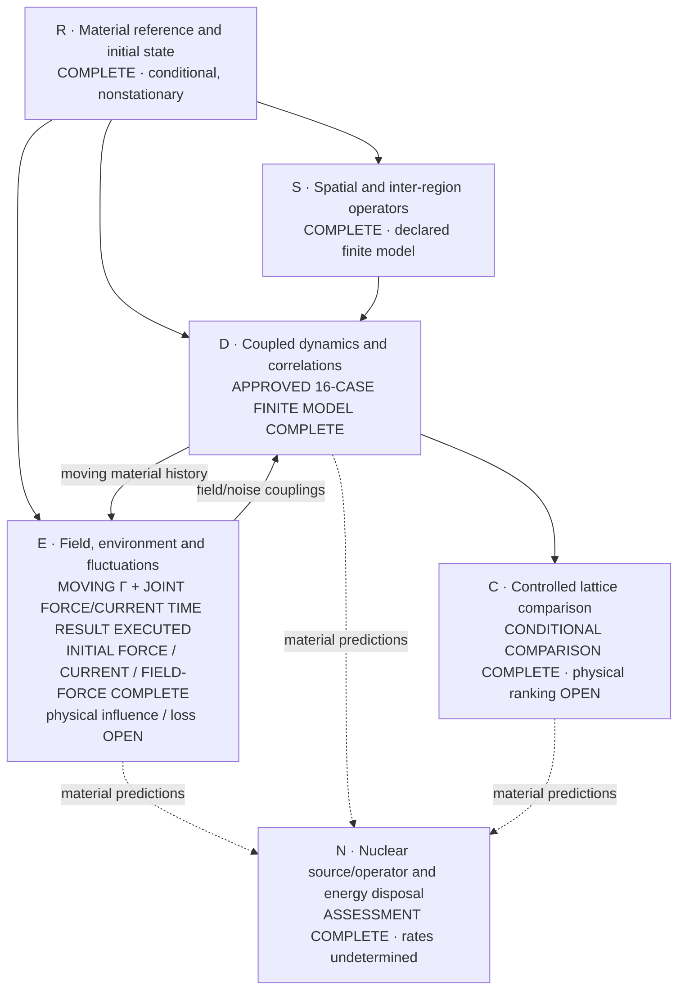

# Ni/H collective-response solution map

The objective remains a material-calibrated many-region simulation, a defensible lattice comparison, and an explicit nuclear-transition/energy-disposal construction ([P254](proposal.yaml)). The approved finite-model simulations are finished. The full physical objective is not: material loss-survival, a physical lattice ranking and nuclear rates remain unestablished.

## Core plan and actual state

Nodes are scientific outputs, not approval checkpoints. Completion labels apply only to the stated scope.

- **Reference/state:** the [full common reference](attempts/0028/full-common-reference-004/summary.json), [original electronic boundary](attempts/0028/full-state-initialization-intake-001.json), [ionic preparation](attempts/0028/ionic-gaussian-material-002/result.json) and [field state/scalar](attempts/0028/joint-field-aggregate-001/result.json) retain the actual source states, nonzero force and declared conditional preparation. They are not equilibrium or physical-convergence claims.
- **Spatial operators:** the [physical finite-q operators/scalar join](attempts/0028/physical-spatial-material-001/result.json) and [independent oracle](attempts/0028/physical-spatial-oracle-003.json) cover the declared periodic representation. Future trajectories are not inferred from symmetry.
- **Original dynamics/comparison:** [every original trajectory/readout](attempts/0029/four-original-structures-finite-dynamics-complete-001.json), [complete comparison admission](attempts/0029/final-four-structure-actual-comparison-admission-001.json), [lossless publication](attempts/0029/complete-comparison-lossless-publication-001.json) and [complete complementary review](attempts/0029/complete-active-model-scientific-review-admission-001.json) are retained. That review covers A29, not the later A30–A32 extension.
- **Environment/influence:** the original [all-source short-time full-PW force covariance](attempts/0028/source-local-material-covariance-complete-intake-001.json), [full-state initial split](attempts/0030/physical-noise-decomposition-native-admission-001.json), [causal output filter](attempts/0030/canonical-force-filter-material-admission-001.json), [frozen-bath forced output](attempts/0031/finite-bath-material-publication-001.json) and [original-output cross terms](attempts/0031/homogeneous-output-cross-material-001.json) are distinct executed results. The moving coupled extension below now includes backreaction rather than treating that forcing as independent added noise.
- **Nuclear bridge:** the [complete source/operator assessment](attempts/0028/nuclear-medium-assessment.md) and [executed sensitive consumer/oracle](attempts/0028/nuclear-medium-assessment-001.json) identify the missing transition/preparation/receiver/transport inputs. Material coherence alone does not determine a nuclear rate or heat; this is not a universal no-go.

## What the completed original simulation shows

All original structures and nested electronic/density representations reached the original saved times. The [compact source-bound observations](attempts/0029/final-saved-result-scientific-summary-001.json) retain unrounded complex correlations, mean energy components, spatial response and raw defects. No original trajectory or preparation was replayed for the final comparison.

At thirty inverse Ry, the same-cell ordered Ni-displacement coherence magnitude spans the following **observed nested-model ranges**. Participation and RMS distance select the maximum representation's finite-dose mean response.

| Structure | Nested magnitude range | Ni participation | Ni RMS distance, bohr |
| --- | ---: | ---: | ---: |
| H-loaded Ni31H6 | 0.989656772–0.990995860 | 1.411314 | 5.676079 |
| Dispersed Ni32H6 | 0.990361626–0.991950536 | 1.923266 | 8.371266 |
| Pristine Ni32 | 0.991116571–0.992658532 | 1.889544 | 8.248076 |
| Vacancy Ni31 | 0.990844966–0.992309963 | 1.438169 | 5.822710 |

Only pristine versus H-loaded has disjoint ranges in this selected conditional observable; the other pairs overlap. Each structure keeps its own preparation. These are not matched state subtractions or physical error bars. Participation measures mean displacement weight, not a number of quantum-coherent cells. Sampled times do not establish a continuous-time lifetime. The published mean energy redistribution is reversible exchange, not heat.

The [saved coupled/clamped contrast](attempts/0030/coupled-clamped-coherence-contrast-001.json) also consumes every eligible matched canonical control while retaining unsupported isotope/preparation comparisons explicitly. It is a contrast between declared noise models, not calibrated irreversible dissipation.

## Moving electron-noise and backreaction: actual result

The [actual moving-hybrid material run](attempts/0032/moving-hybrid-material-native-admission-002.json) completed the requested mean trajectory and coupled Gaussian covariance/readouts. Its [exact result and lossless numeric publication](attempts/0032/moving-hybrid-material-publication-002.json) preserve original input/state identities, physical adjoints, raw complex values and solver-coordinate banks.

The selected original electronic sector is promoted once from its active density to the finite bath containing every original raw state column and the selected empty directions. Other electronic sectors remain dynamic. The same added ionic Hamiltonian drives mean, forward response and the true nonconjugating transpose; existing density/field vertices use the saved active embedding. Actual canonical mean/tangent coordinates and Fourier factors are unchanged. The interaction picture diagonalizes H only, never refills or diagonalizes the original nonstationary density.

The [owning Hamiltonian/Fock/tangent/transpose proof](attempts/0032/hybrid-gamma-owning-oracle-001.json) covers the new coupling boundary; earlier proofs were carried forward. The first runtime allocation [timed out after useful partial work](attempts/0032/moving-hybrid-first-native-timeout-001.json). Its missing interaction-coordinate bank is recorded rather than retroactively reconstructed as execution provenance. The corrected complete run persists the actual bank before evolution, input-binds backward boundaries, retains raw forward/backward reconstruction differences and does not repair them.

The [actual saved-data comparison](attempts/0032/saved-gamma-model-contrast-001.json) uses the **same original preparation, Ni1/x Γ observable and existing ordered normalizer**, without another trajectory:

| Declared Γ model at thirty inverse Ry | Magnitude | Phase, radians | Equal-time variance, bohr² |
| --- | ---: | ---: | ---: |
| Original active-model reconstruction | 0.992586383 | 3.043950033 | 8.674647230e-05 |
| Moving source0 finite-bath enrichment | 0.992374391 | 3.059828684 | 8.671634520e-05 |

This is a coupled **model-enrichment contrast**, not an isolated positive noise addition: the literal source Hamiltonian, moving response and fluctuations change together. It is not a new real-space curve, a passive-noise error bar, material loss or a lattice ranking.

The scope is one Γ wavevector and one enriched electronic sector with two selected extra ionic-force channels. The initial second-mode force variance was under-resolved by the selected bath; neither that discrepancy nor the discarded selection proxy is a late-time error bound. Remaining sectors/wavevectors, direct omitted field/density channels and physical representation/size errors are not calibrated by this example. No irreversible damping or survival under unmodeled losses is inferred.

## What drives the represented noise, and its causal response

The [actual saved-data influence consumer](attempts/0033/saved-noise-budget-and-influence-native-admission-001.json) completed in 15.969469361007214 seconds, with no trajectory, physical H/force action, H eigensolve or new Γ cache. It consumes the original preparation duals and their actual persisted coordinate bank. The [new narrow Fock/oscillator/gauge/sign oracle](attempts/0033/owning-new-consumer-oracle-001.json) exercises the new consumer boundaries; old proofs and trajectories are carried forward. Both [complete independent scientific reviews](attempts/0033/complete-scientific-review-admission-001.json) found the scoped outputs correct, with complete empty finding arrays; their [exact reviewed map](attempts/0033/reviewed-solution-snapshot-001.md) is retained.

At thirty inverse Ry, the **same moving Γ model's** equal-time Ni1/x variance has these initial-condition origins ([exact result](attempts/0033/saved-noise-budget-and-influence-material-result-001.json)):

| Original preparation component | Variance contribution, bohr² |
| --- | ---: |
| Ionic | 8.598088153e-05 |
| Field | 3.088957814e-11 |
| Electronic, all represented sectors | 7.354327867e-07 |
| Total | 8.671634520e-05 |

All ionic/field cross blocks and individual electronic sectors remain in the exact complex publication. This attributes the initial fluctuations through one coupled response; it is not noise generated along a path or energy dissipated. Source0's retained/omitted split acts on the final pulled-back observable in its finite bath, not a counterfactual with omitted dynamics switched off. Every normalized contribution uses the same full-output denominator; magnitudes must not be independently summed.

The same consumer computes the separate **nonstationary two-mode force noise and causal commutator-response pair** from the paid frozen-literal-H bath. Original state coherences, both physical force legs and the existing `-uF` Kubo sign are retained. This is a two-time object, not a stationary positive spectrum, a fitted linewidth, a recovered moving history or independent noise to add atop A32. Instantaneous scalar/contact derivatives remain separate.

## Initial force-noise source coverage

The [actual full-source completion](attempts/0034/actual-full128-force-completion-001.json) records the original production's successful exit at 17:44:30 UTC and the complete aggregate's successful exit at 17:45:02 UTC. All 128 distinct original spin/internal-k sectors are included, each actual 1/64 weight once; pilot1 is joined exactly once and the already paid source0 force legs are reused. The [exact aggregate](attempts/0034/full128-initial-force-material-aggregate-001.json) and [lossless publication receipt](attempts/0034/full128-initial-force-lossless-publication-001.json) preserve every complex pair, all retained/omitted cross orders, original state/source identities and actual costs. The [complete corrected independent implementation reviews](attempts/0034/complete-corrected-review-admission-001.json) retain and resolve the four execution/admission findings without changing the force or covariance mathematics.

This completes the initial external-Γ force-noise sum in two fixed output-directed modes. It does not supply all external momenta, a moving full-source influence kernel, finite-q density, irreversible loss, a lifetime or heat. The retained/omitted entries are operators projected within the same original state, not a separately simulated counterfactual or a late-output error bound.

## Initial physical-current noise

The [actual full current production and aggregate admission](attempts/0035/current-completion-owner-001/full-current-production-terminal-admission.json) records both disjoint shards' successful Native exits and the complete 128-sector aggregate at 18:15:58 UTC. There are 126 genuinely new successful cases, no failed case or retry; committed source1 is reused and external pilot0 is joined exactly once. The [exact full aggregate](attempts/0035/full128-initial-current-material-aggregate-001.json) retains all nine ordered complex Cartesian pairs and all retained/omitted cross orders. The [two independent implementation reviews](attempts/0035/complete-current-scientific-review-admission-001.json) retain their original code/pilot scope; the [complete complementary full-dataset reviews](attempts/0036/complete-full-noise-scientific-review-admission-001.json) now cover all three complete initial-noise datasets and the canonical field-force boundary, with complete empty finding arrays.

The [construction](attempts/0035/implementation-contract-001.json) uses all original raw state columns and the full plane-wave frame, the existing physical `J=-L/2` vertices, all nine ordered Cartesian pairs and all retained/omitted cross orders. The raw-current aggregate is per-cell initial uniform-current noise; its canonical field coupling is handled by the separate saved-data consumer below. Separate force and current marginals do not supply their missing joint cross covariance, a moving influence kernel, finite-q density, irreversible loss or heat; they must not be added as independent noise atop the completed moving model.

The [actual full canonical-field consumer](attempts/0035/current-completion-owner-001/dependent-full-field-readout-terminal-admission.json) then consumed that settled complete aggregate once and exited successfully, preserving all 128 sectors. Its [exact result](attempts/0036/full128-initial-canonical-field-force-material-result-001.json) maps the saved current covariance to the original global electronic generalized force entering `Pi-dot`, using the actual N64 cell, polarizations and Hartree/Ry convention. The [sensitive owning proof and real-consumer evidence](attempts/0036/actual-canonical-field-force-partial-admission-002.json) retain a direct differentiated-scalar/Fock calculation exposing sign, conversion, spatial-count, polarization, complex-pair and partial-renormalization errors. The first strict native-scalar serialization failure and source-level repair remain preserved; no physical action or unchanged proof was replayed for the full readout. This is not initial `Pi` state variance or a propagated field trajectory. Both [complete scientific reviews](attempts/0036/complete-full-noise-scientific-review-admission-001.json) are correct at their declared scopes; the exact reviewed snapshot and original report bytes are preserved.

## Expanded source0 temporal influence

The [actual expanded physical bath](attempts/0037/actual-complete-expanded-bath-admission-003.json) completed successfully: all 346 original raw state columns, 692 additional directions, both Hamiltonian legs and both true legs of the two selected forces. The [exact metadata publication](attempts/0037/expanded-bath-exact-metadata-publication-003.json) retains every initial full-PW/projected force pair and the original coordinate/state/operator provenance; its 373 MB numeric bank remains authenticated locally, not falsely represented as embedded in Git. The two actual integration failures—cached-versus-current implementation provenance and the ionic API's small-column requirement—are preserved with their owning fixes and charged lost work.

The [actual temporal consumer](attempts/0037/actual-complete-expanded-temporal-influence-admission-001.json) completed successfully, with no further physical actions or preparation. The [exact result](attempts/0037/expanded-temporal-influence-material-result-001.json) preserves the actual final Ni1/x causal output filter, all nine ordered complex covariance pairs, both cross orders and the saved spectral coordinates.

| Source0/Gamma force contribution at final time30, bohr² | Old8 extra directions | New692 extra directions |
| --- | ---: | ---: |
| Full force vertex | 9.360139172e-08 | 9.434679430e-08 |
| Retained vertex | 1.296452226e-08 | 1.297069136e-08 |
| Omitted vertex | 8.098503832e-08 | 8.157562591e-08 |

The cross blocks belong to the same bath, so the diagonal rows must not be added independently. This is a same-observable, original-state, frozen-H/two-mode model-enrichment contrast—not a late error bound, convergence certificate, independent noise added to A32, full-source/moving influence or irreversible loss. The [construction](attempts/0037/implementation-contract-001.json) reuses the existing subspace, polynomial-filter and CAR mathematics; unchanged [sensitive owning evidence](attempts/0031/owning-block-oracles-001.json) is carried forward rather than replayed. Both actual failures and all charged work remain in the admission. Both [complete complementary A37 scientific reviews](attempts/0037/complete-expanded-temporal-scientific-review-admission-001.json) are correct with complete empty finding arrays; their exact reviewed map and original report bytes are retained.

## Joint force–current temporal influence

The [actual current projection](attempts/0038/physical-current-projection-complete-002.json) and [complete joint temporal result](attempts/0038/actual-complete-joint-temporal-influence-admission-001.json) are finished. They reuse the paid expanded bath, actual spectral coordinates, original nonstationary state and ionic filtered operators. Only the missing uniform-current contribution is newly integrated through the original canonical field-force filter, using the existing source amplitude `sqrt(N*w0)*M`, with `M` twice the original polarization matrix and actual `N*w0=1`. No Hamiltonian/force action, basis selection, spectral eigensolve or original trajectory is repeated.

For the same final Ni1/x output, let `I` denote the existing ionic-force contribution and `E` the new electronic current through the field filter. The [exact result](attempts/0038/joint-temporal-influence-material-result-001.json) retains all25 ordered complex pairs, including both `I,E` and `E,I`; the joint variance contains both, not an independent sum of two noise variances.

| Source0/Gamma connected output covariance at final time30, bohr² | Real part | Imaginary part |
| --- | ---: | ---: |
| Field/current `E,E` | 3.470235440e-12 | 5.383615201e-27 |
| Ionic–field `I,E` | 2.301990969e-11 | -2.925779160e-12 |
| Field–ionic `E,I` | 2.301990969e-11 | 2.925779160e-12 |
| Joint full vertex | 9.439630436e-08 | -8.058922512e-22 |
| Joint retained vertex | 1.297757157e-08 | -4.855492118e-23 |
| Joint omitted vertex | 8.161440561e-08 | -5.505410784e-22 |

The [new focused owning oracle](attempts/0038/owning-joint-saved-spectral-oracle-001.json) exercises the public serialized spectral loader, independent matrix-exponential/time-quadrature and direct Fock readout, exposing wrong adjoint-moment transpose/conjugation, independent-adjoint replacement, omitted cross orders and wrong field normalization/sign. Existing A31/A36 proofs are carried forward, not rerun. The [real first metadata-wording failure](attempts/0038/actual-current-preaction-failure-and-owning-repair-001.json) and its owning physical-invariant comparator fix remain recorded; no wording allowlist or physical-state change was used.

The original current evaluations were intentionally repeated where A35 had not retained their action arrays; that work is charged, not called free cache reuse. The complete initial full-PW/finite-bath current deficits are preserved. The authentic current and new joint operator banks remain local, without copying the old large banks. This is a source0/Γ/two-ionic-mode/frozen-H contribution through a fixed original filter—not a late error bound, full-source/moving/density influence, independent correction added to A32, irreversible loss, material ranking, nuclear rate or whole-E closure. Complete complementary scientific reviews are pending.

## Existing solutions reused

Only actual reusable solutions are listed; missing physics is not represented by an inventory placeholder.

| Existing solution | Reuse in this campaign | Evidence |
| --- | --- | --- |
| Saved-density physical H/K, full-PW force/current and finite-q operators | Reuse original source/state/scalar and shared physical factors rather than rebuild DFT backgrounds or replace H by energy labels | [A25](attempts/0025/review-admission.json), [A26](attempts/0026/review-admission.json), [physical spatial join](attempts/0028/physical-spatial-material-001/result.json) |
| Original state/preparation, Bloch grid and canonical controls | Keep raw Gram/D, explicit spins, original cells/masses/field preparation and matched-control meaning; no population refill | [A27](attempts/0027/review-admission.json), [full initial boundary](attempts/0028/full-state-initialization-intake-001.json), [matched controls](attempts/0028/matched-clamped-batch-complete-001.json) |
| Moving active mean/tangent/transpose and ordered readout | Reuse `reduced_electronic_dynamics.py`, `reduced_electronic_correlations.py` and `normalized_ordered`; consume saved results rather than repeat trajectories | [Original finite/Fock evidence](attempts/0029/executed-finite-oracle-admission-001.json), [exact probe reuse](attempts/0029/probe-reuse-actual-admission-001.json), [complete comparison](attempts/0029/final-four-structure-actual-comparison-admission-001.json) |
| Canonical CAR/Fock contractions, actual output filter and physical action cache | Preserve original nonorthogonal state, both true legs and cross orders; use the actual forcing interval and paid H/force data | [Noise split proof](attempts/0030/noise-projection-oracle-001.json), [causal filter](attempts/0030/canonical-force-filter-publication-001.json), [finite-bath proofs](attempts/0031/owning-block-oracles-001.json), [moving model](attempts/0032/hybrid-gamma-owning-oracle-001.json) |
| Saved expanded bath/spectral coordinates and canonical field-current mapping | Reuse the actual A37 coordinate/state/operator banks and A36 map for the joint force–current output, without new H/force actions, basis selection or spectral reconstruction | [Saved bath](attempts/0037/actual-complete-expanded-bath-admission-003.json), [actual spectra/filter](attempts/0037/actual-complete-expanded-temporal-influence-admission-001.json), [canonical map](attempts/0036/canonical-field-force-source0-partial-material-result-002.json), [joint execution](attempts/0038/actual-complete-joint-temporal-influence-admission-001.json) |
| Evaluated nuclear/product/transport data and operator assessment | Reuse actual channel domains, product energies and conditional transport; do not invent amplitudes, missing material tables or heat | [Product ledger](attempts/0028/nuclear-product-energy-ledger.json), [measured channels](attempts/0028/measured-nuclear-channels-001.json), [transport](attempts/0028/nuclear-energy-transport-001.json), [assessment](attempts/0028/nuclear-medium-assessment.md) |

Earlier force, energy and atom/species readouts remain in their [source-bound A28 publications](attempts/0028/retained-local-raw-artifacts-001.json); they are not repeated here as progress minutiae. Original raw scientific data and failed attempts remain preserved, not necessarily stored in Git.

## What is still required to close the physical objective

1. **E — physical influence at the required scope:** extend the demonstrated source/Γ/mode coverage and compute the omitted density/current vertices. Wider same-model electronic influence is additional computation, not inherently missing experimental data. Collisional electronic and anharmonic channels require their own material calculation/model extension; conservative screening or harmonic redistribution does not supply them. Specimen radiation, reservoirs and random-disorder loss additionally need the actual boundary/environment/statistics. A finite bath or numerical broadening does not establish irreversible material loss.
2. **C — a defensible design decision:** propagate relevant reference/model, spatial-size and physical-noise uncertainty into matched comparisons. Different original preparations and unresolved physical errors still prevent a material ranking. Extra digits or repeated same-model checks do not supply that bridge.
3. **N — any actual nuclear rate/heat prediction:** provide the specific channel/preparation, normalized transition/receiver amplitudes, nuclear-frequency matching, exclusive spectra and finite-specimen transport identified in the completed assessment. Do not promote material coherence to a rate.

The [complete complementary A32 scientific reviews](attempts/0032/complete-moving-hybrid-scientific-review-admission-001.json) are finished, with complete empty finding arrays at the declared scope. Their [exact reviewed map](attempts/0032/reviewed-solution-snapshot-001.md) is retained; this delivery-status sentence adds no scientific claim. The distinct authorized final merge remains open. No sixteen-case replay, generic qualification campaign or narrower objective is substituted for the physical obligations above.
