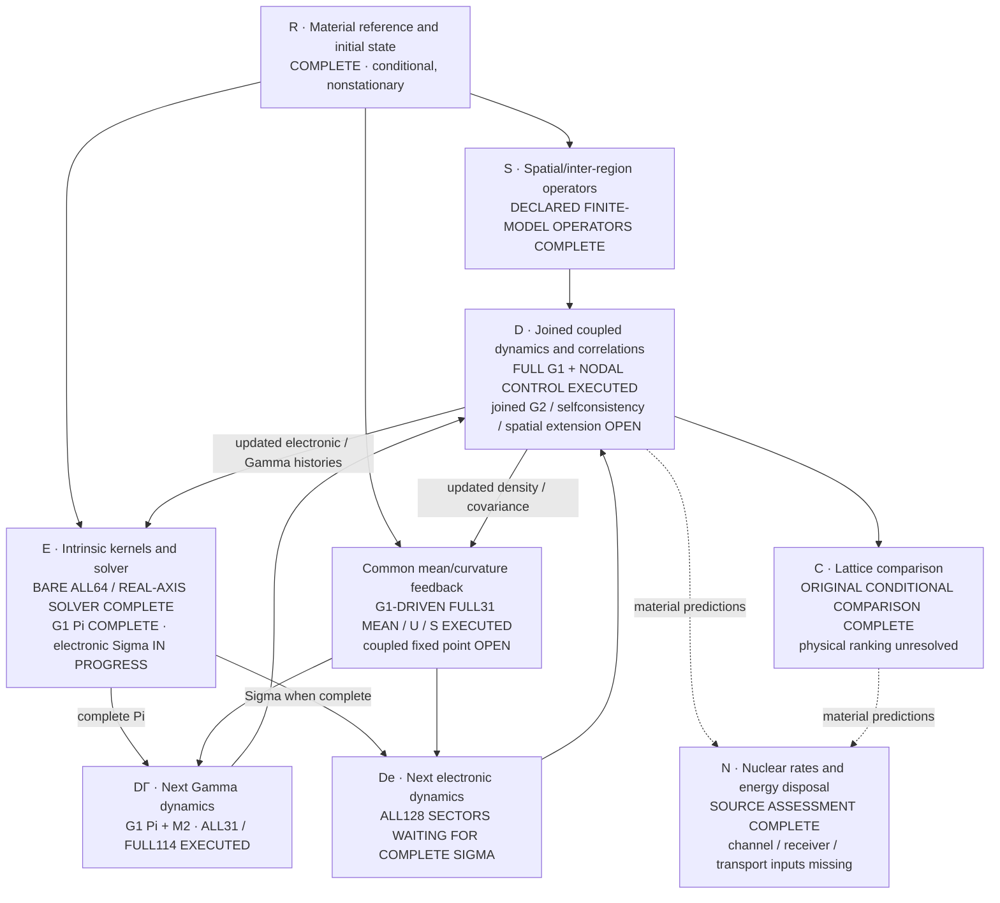

# Ni/H collective-response solution map

The objective remains a material-calibrated many-region simulation, a defensible lattice comparison, and an explicit nuclear-transition/energy-disposal construction ([P254](proposal.yaml)). The original finite-model simulations, first full-duration intrinsic update and next Gamma-only block are executed. The physical objective is **not complete**: coupled selfconsistency, decision-relevant numerical/model uncertainty, material loss-survival, a physical lattice ranking and nuclear rates remain unresolved.

## Core plan and actual state

Nodes are scientific outputs, not approval checkpoints. Completion labels apply only to the stated scope.

- **R — reference/state:** the [common material reference](attempts/0028/full-common-reference-004/summary.json), [electronic boundary](attempts/0028/full-state-initialization-intake-001.json), [ionic preparation](attempts/0028/ionic-gaussian-material-002/result.json) and [field/scalar construction](attempts/0028/joint-field-aggregate-001/result.json) retain the original states and nonzero force. These are conditional preparations, not equilibrium or physical-convergence results.
- **S — spatial operators:** the [finite-q density/ionic construction](attempts/0028/physical-spatial-material-001/result.json) and [full-PW finite-q current/true-adjoint execution](attempts/0039/actual-spatial-current-component-admission-001.json) cover their declared representations. The latter uses straight-line gauging of the ordinary-NC kernel and selected original columns; it is not a populated all-source spatial response or unique all-electron transverse accuracy.
- **E — common kernels and solver:** the [complete initial/bare canonical bank and actual A62 consumer](attempts/0082/complete-handoff.json) cover all internal momenta, all genuine ordered pairs on the requested uniform grid, and the six greater/lesser/retarded Sigma/Pi arrays, including the [once-only joint Gamma contribution](attempts/0075/handoff.json). The [result-only real-axis implementation and sensitive equivalence observation](attempts/0085/verification-001.json) retain the pinned retarded solver, both noncommuting convolution orders, initial preparation and two-sided noise transport. The [actual G1-driven joint and complete all64 cubic family](attempts/0087/actual-dressed-joint-cubic-and-bank-observation.json) and [saved complete Pi publication](attempts/0089/actual-complete-Pi-publication.json) are complete. The [first complete dressed EE q0](attempts/0087/actual-first-dressed-EE-q0-observation.json), [complete electronic-only-input EE q1](attempts/0088/actual-complete-dressed-EE-q1-observation.json), and [initial complete raw EI contributions](attempts/0087/actual-EI9-EI11-bank-observation.json) are now banked. The remaining momenta still prevent a complete dressed Sigma. These contractions consume actual independent G1 histories, not the Gaussian reference constructed from the new mean.
- **M — mean/curvature:** the [original full-duration mean/U/S update](attempts/0078/complete-handoff.json) and [new feedback from the actual dressed G1 state](attempts/0086/actual-dressed-mean-observation.json) are executed. Both reuse the [paid covariance-force cache](attempts/0074/complete-handoff.json) and unchanged common cubic scalar. The new saved reader consumes the actual raw G1 density/covariance separately from the original preparation, with no new non-Gamma contractions. Its Gaussian reference is not a repaired G1 state or the next Dyson iterate; collision feedback and a coupled fixed point remain open.
- **D — actual dynamics:** the [original sixteen trajectories/readouts](attempts/0029/four-original-structures-finite-dynamics-complete-001.json), [nodal-mean coupled control](attempts/0083/handoff.json), and [first full-duration intrinsic observation](attempts/0084/actual-full31-observation.json) are executed. G1 consumes every active electronic sector and the full Gamma position space. The [next full31/full114 Gamma block from Pi[G1] and M2](attempts/0089/actual-Gamma-block-observation.json) is also executed and saved: it does not mathematically require electronic Sigma. Its [actual saved reader and exact-input reuse](attempts/0089/actual-Gamma-result-reuse-observation.json) preserve the literal external bank for the later join. The next electronic sectors and joined G2 remain pending; non-Gamma bosons remain the prescribed original bath. Neither result establishes full spatial/selfconsistent closure.
- **C — comparison:** the [original complete conditional comparison](attempts/0029/final-four-structure-actual-comparison-admission-001.json) is retained below. Different preparations and unresolved model/physical uncertainty prevent a material ranking.
- **N — nuclear bridge:** the [source/operator assessment](attempts/0028/nuclear-medium-assessment.md) and [sensitive consumer](attempts/0028/nuclear-medium-assessment-001.json) identify missing transition/preparation/receiver/transport inputs. Material coherence alone does not determine a nuclear rate or heat; this is not a universal no-go.

## First full-duration intrinsic result

The [actual full31 observation](attempts/0084/actual-full31-observation.json) binds the completed run, published provider, genuine saved-history readout and matched-control evidence. All 128 active twelve-band electronic sectors and all 114 Gamma position coordinates were consumed at the genuine saved nodes zero through thirty inverse Ry. This is one Picard update, not a fixed point.

The original Gamma call timed out without a resumable in-flight result. The [Gamma-only recovery](attempts/0084/recovery-api.json) reused its authentic packed input and all completed electronic banks. The replacement discarded only zero imaginary/mixed work, unused diagnostic products and redundant contour storage. The [changed-block oracle](attempts/0085/verification-001.json) exercised both statistics, all supported integration orders, startup-only and propagated noncommuting histories, with sensitive dropped-initial/dropped-noise/wrong-order mutations. The [actual material result](attempts/0084/actual-full31-observation.json), not that oracle alone, establishes completion of this scoped update.

The same final-time **Gamma Ni1/x contribution**, using the original ordered normalizer, is:

| Declared model | Normalized magnitude at time thirty |
| --- | ---: |
| Original bare reference, original mean | 0.9961012006179318 |
| Coupled Gaussian control at archived common mean/rho nodes | 0.992586567054086 |
| First common intrinsic/cubic Picard update | 0.9920313155255156 |
| Next Gamma-only block at G1-driven mean/Pi; electrons pending | 0.9942726776591464 |

These are saved model outputs, not error bars or calibrated irreversible loss. The [observation](attempts/0084/actual-full31-observation.json) verifies the control's original reference, preparation, probe, normalization, endpoints and archived mean identity. The control uses linear mean/rho interpolation; it is not the unarchived continuous-mean trajectory. The bare reference has a different mean and is not the matched control. Neither endpoint contrast is a full real-space momentum-summed coherence curve.

The next Gamma-only row comes from its [actual run and owning raw readout](attempts/0089/actual-Gamma-block-observation.json). Its mean and collision inputs differ from G1. It is neither a matched-control contrast nor full G2; the all128 electronic continuation still requires the complete dressed Sigma.

**Particle number is not conserved by this raw first iterate.** Its complete complex trace, initial-state identities, density eigenvalue/Hermiticity diagnostics and raw iterate differences remain in the [observation and bound readout](attempts/0084/actual-full31-observation.json). No clipping, population refill, Hermitization or fitted damping was applied. The oscillating trace and unclosed feedback must not be interpreted as physical electron loss or heat. A finite-step model contrast does not establish temporal accuracy or a lifetime.

## Completed original conditional lattice comparison

The [source-bound original observations](attempts/0029/final-saved-result-scientific-summary-001.json) and [lossless publication](attempts/0029/complete-comparison-lossless-publication-001.json) retain unrounded complex correlations, energies, spatial responses and raw defects. No original trajectory was replayed for the current intrinsic update.

At thirty inverse Ry, these are **observed nested-model ranges** of the same-cell ordered Ni-displacement coherence magnitude. Participation and RMS distance refer to the maximum representation's finite-dose mean response.

| Structure | Nested magnitude range | Ni participation | Ni RMS distance, bohr |
| --- | ---: | ---: | ---: |
| H-loaded Ni31H6 | 0.989656772–0.990995860 | 1.411314 | 5.676079 |
| Dispersed Ni32H6 | 0.990361626–0.991950536 | 1.923266 | 8.371266 |
| Pristine Ni32 | 0.991116571–0.992658532 | 1.889544 | 8.248076 |
| Vacancy Ni31 | 0.990844966–0.992309963 | 1.438169 | 5.822710 |

Only pristine versus H-loaded has disjoint ranges in this selected conditional observable; other pairs overlap. Each structure keeps its own preparation. These are not matched-state subtractions or physical error bars. Participation is mean displacement weight, not a count of quantum-coherent cells. Sampled times do not establish a continuous-time lifetime; reversible mean-energy redistribution is not heat. The [complete original scientific review](attempts/0029/complete-active-model-scientific-review-admission-001.json) covers that original comparison, not later intrinsic extensions.

## Existing solutions reused

Only actual reusable solutions are listed; missing physics is not an inventory placeholder.

| Existing solution | Actual reuse | Evidence |
| --- | --- | --- |
| Saved-density physical H/K, full-PW force/current, finite-q operators and original state/preparation | Preserve the literal scalar, coherent density, explicit spins, physical adjoints, cells/masses and Bloch grid; do not rebuild DFT backgrounds or refill populations | [Physical spatial join](attempts/0028/physical-spatial-material-001/result.json), [initial boundary](attempts/0028/full-state-initialization-intake-001.json), [finite-q current](attempts/0039/actual-spatial-current-component-admission-001.json) |
| Moving mean/tangent/true transpose, CAR/W0 contraction and ordered readout | Reuse original density/K feedback and probe for the nodal-mean endpoint control, rather than identify saved S alone with the coupled control | [Original finite/Fock evidence](attempts/0029/executed-finite-oracle-admission-001.json), [actual control](attempts/0083/handoff.json) |
| Compact common cubic scalar, full37 source and paid all-q covariance-force contractions | Reuse mean force, curvature/JVP and true transpose; change only the dressed-state feedback, not the unchanged bath/source | [Common scalar/maps](attempts/0047/actual-complete-full37-cubic-feedback-component-admission-001.json), [full-window cache](attempts/0074/complete-handoff.json), [mean update](attempts/0078/complete-handoff.json) |
| Physical bare Hartree factors, original momentum/feature maps and generic supplied-history contractions | Retain direct/exchange, head/volume/N factors and original vertices; evaluate actual independent G1 legs rather than substitute a Gaussian fit. Keep PBE K and mean Hartree/Fock separate from the correlation residual | [Bare factors](attempts/0044/bare_coulomb_factors.py), [generic evaluator](attempts/0060/streamed_ee.py), [first actual G1 EI q0](attempts/0087/actual-first-dressed-EI-q0-observation.json) |
| Retained all64 cubic collision family and paid original q0 pairs | Replace only the changed Gamma/internal-q0 contribution. Preserve the unchanged non-Gamma terms; restore the missing original q0 cache once and retain it, rather than replay all momenta | [Retained complete family](attempts/0082/complete-handoff.json), [q0 replacement implementation](attempts/0087/cubic_update.py), [actual retained-input declaration](attempts/0087/preregistration.json) |
| Pinned NESSi retarded Dyson/VIE2 plus source-derived two-sided Keldysh transport | Preserve coherent Gaussian preparation, both independent product orders, retarded diagonal and zero mixed branch; the new real-axis path removes unused work, not physical content | [Pinned upstream](https://github.com/nessi-cntr/nessi/tree/6bb4c832a209d2c079fdbbdbc5c05ab8d5503aa6), [primary paper](sources/nessi-schueler-2020.pdf), [original structural solver](attempts/0054/structure-preserving-keldysh-handoff-001.json), [new actual verification](attempts/0085/verification-001.json) |
| Canonical supplied-history banks, existing Gamma-slot solver and saved-history reader/readout | Reuse complete sums and paid electronic sectors. Run the independently ready Gamma block without waiting for Sigma; retain its exact complete-bank binding for the later electronic join, without copying or solving Gamma again | [G1 recovery](attempts/0084/recovery-api.json), [full G1](attempts/0084/actual-full31-observation.json), [actual next Gamma block](attempts/0089/actual-Gamma-block-observation.json), [exact reuse observation](attempts/0089/actual-Gamma-result-reuse-observation.json) |
| Saved expanded bath/spectral coordinates, canonical field-current mapping and joint output filters | Carry forward represented force/current/density cross orders in the original state, rather than add independent noise marginals or redo physical actions | [Joint force/current output](attempts/0038/actual-complete-joint-temporal-influence-admission-001.json), [complete density join and saved consumer](attempts/0042/actual-saved-density-output-consumer-admission-001.json) |
| Evaluated nuclear/product/transport data and operator assessment | Reuse actual channel domains, product energies and conditional transport; do not invent missing amplitudes, material tables or heat | [Product ledger](attempts/0028/nuclear-product-energy-ledger.json), [measured channels](attempts/0028/measured-nuclear-channels-001.json), [transport](attempts/0028/nuclear-energy-transport-001.json), [assessment](attempts/0028/nuclear-medium-assessment.md) |

Earlier component results, source snapshots, scoped reviews and failures remain in their linked attempt artifacts; a scoped old review is not a review of the new full-duration result. Historical payload bindings are not current-availability claims. User-authorized cleanup retired obsolete failed working buffers while preserving the current inputs, mean, canonical banks and completed simulation state; the [ordinary post-cleanup production/consumer](attempts/0081/postcleanup-first-required-case-smoke-001.json) completed without a separate replay.

## Work still required to close the physical objective

1. **E/D — close the coupled intrinsic evolution.** The G1-driven mean/curvature, complete Pi and next Gamma-only block are now executed. Finish the remaining dressed Sigma momenta from actual G1, then advance all128 electronic sectors with M2 and reuse the exact saved Gamma block for those same inputs. Preserve the original scalar/preparation and represented-response/noise replacement. Resolve the coupled fixed point, particle-number/conservation defect and decision-relevant time error, then the relevant spatial influence. Retain PBE/correlation-residual matching uncertainty. A completed first update, its new mean and a Gamma-only successor do not supply these missing steps. Wider same-model intrinsic/spatial work remains computation, not inherently missing experimental data; actual specimen radiation, reservoirs and random-disorder losses additionally require boundary/environment/statistics. A finite bath, harmonic redistribution or numerical broadening is not irreversible material loss.
2. **C — obtain a defensible design decision.** Propagate relevant reference/model, spatial-size and physical-noise uncertainty into matched comparisons. Different original preparations and unresolved physical errors still prevent a material ranking. More digits or repeated same-model checks do not create that bridge.
3. **N — provide the inputs for an actual nuclear rate/heat prediction.** The specific channel/preparation, normalized transition/receiver amplitudes, nuclear-frequency matching, exclusive spectra and finite-specimen transport remain required by the completed assessment. Do not promote material coherence to a rate.

The canonical issue and source PR remain open. No successful prefix, first Picard update, generic qualification campaign or narrower objective is substituted for the physical obligations above.
