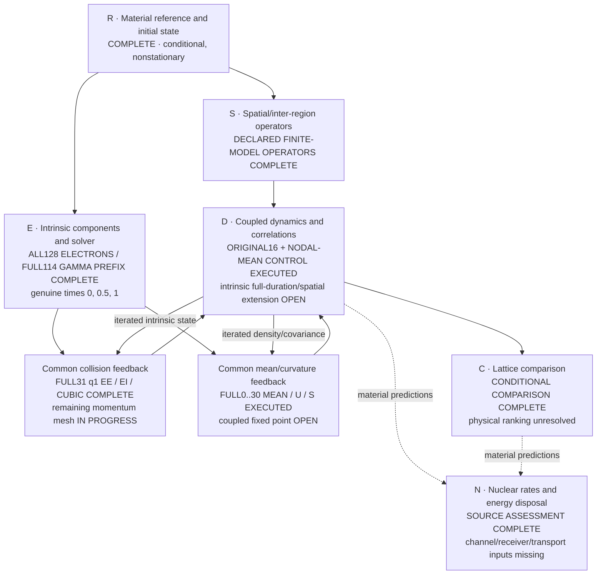

# Ni/H collective-response solution map

The objective remains a material-calibrated many-region simulation, a defensible lattice comparison, and an explicit nuclear-transition/energy-disposal construction ([P254](proposal.yaml)). The approved finite-model simulations are finished. The full physical objective is not: material loss-survival, a physical lattice ranking and nuclear rates remain unestablished.

## Core plan and actual state

Nodes are scientific outputs, not approval checkpoints. Completion labels apply only to the stated scope.

- **Reference/state:** the [full common reference](attempts/0028/full-common-reference-004/summary.json), [original electronic boundary](attempts/0028/full-state-initialization-intake-001.json), [ionic preparation](attempts/0028/ionic-gaussian-material-002/result.json) and [field state/scalar](attempts/0028/joint-field-aggregate-001/result.json) retain the actual source states, nonzero force and declared conditional preparation. They are not equilibrium or physical-convergence claims.
- **Spatial operators:** the [physical finite-q density/ionic operators and scalar join](attempts/0028/physical-spatial-material-001/result.json) and [independent oracle](attempts/0028/physical-spatial-oracle-003.json) cover the declared finite-model representation. The [new finite-q physical current and true adjoint](attempts/0039/actual-spatial-current-component-admission-001.json) have now actually executed on original Ni/H full-PW data, with explicitly chosen straight-line gauging of the ordinary-NC kernel. This is a selected-column operator result, not populated response or unique all-electron transverse accuracy.
- **Original dynamics/comparison:** [every original trajectory/readout](attempts/0029/four-original-structures-finite-dynamics-complete-001.json), [complete comparison admission](attempts/0029/final-four-structure-actual-comparison-admission-001.json), [lossless publication](attempts/0029/complete-comparison-lossless-publication-001.json) and [complete complementary review](attempts/0029/complete-active-model-scientific-review-admission-001.json) are retained. That review covers A29, not the later A30–A32 extension.
- **Environment/influence:** the original [all-source short-time full-PW force covariance](attempts/0028/source-local-material-covariance-complete-intake-001.json), [full-state initial split](attempts/0030/physical-noise-decomposition-native-admission-001.json), [causal output filter](attempts/0030/canonical-force-filter-material-admission-001.json), [frozen-bath forced output](attempts/0031/finite-bath-material-publication-001.json) and [original-output cross terms](attempts/0031/homogeneous-output-cross-material-001.json) are distinct executed results. The moving coupled extension below now includes backreaction rather than treating that forcing as independent added noise.
- **Nuclear bridge:** the [complete source/operator assessment](attempts/0028/nuclear-medium-assessment.md) and [executed sensitive consumer/oracle](attempts/0028/nuclear-medium-assessment-001.json) identify the missing transition/preparation/receiver/transport inputs. Material coherence alone does not determine a nuclear rate or heat; this is not a universal no-go.
- **Current core work:** short-prefix repeats have stopped. The [full-duration mean/U/S update](attempts/0078/complete-handoff.json) and [once-only joint Gamma contribution](attempts/0075/handoff.json) are complete. Remaining unique collision-kernel momenta are being [produced](attempts/0081/preregistration.json) and [serially accumulated](attempts/0082/preregistration.json), preserving paid work rather than replaying the original sixteen trajectories.
- **Independent control completed:** the [actual nodal-mean coupled Gaussian endpoint control](attempts/0083/handoff.json) retains the original density/K feedback, CAR/W0 preparation and probe. It reuses the saved mean/rho nodes and Phi000; saved S alone would omit represented electronic feedback. Linear mean/rho interpolation remains an explicit approximation, not a continuous-mean match or temporal-accuracy result.
- **Next simulation step:** finish the complete momentum sum and run the full-duration common-state Dyson continuation with the already-computed mean. Neither the completed components nor this control are the full intrinsic trajectory, coupled fixed point or physical calibration.

Both [complete independent reviews of the earlier A42–A45 scoped components](complete-component-wave-scientific-review-admission-001.json) are correct with empty current/incremental finding arrays. Original resolved, dismissed and carried findings/failures remain retained. Those verdicts do not cover the new A46–A50 extensions, whole-E closure or the final distinct authorized merger.

## What the completed original simulation shows

All original structures and nested electronic/density representations reached the original saved times. The [compact source-bound observations](attempts/0029/final-saved-result-scientific-summary-001.json) retain unrounded complex correlations, mean energy components, spatial response and raw defects. No original trajectory or preparation was replayed for the final comparison.

At thirty inverse Ry, the same-cell ordered Ni-displacement coherence magnitude spans the following **observed nested-model ranges**. Participation and RMS distance select the maximum representation's finite-dose mean response.

| Structure | Nested magnitude range | Ni participation | Ni RMS distance, bohr |
| --- | ---: | ---: | ---: |
| H-loaded Ni31H6 | 0.989656772–0.990995860 | 1.411314 | 5.676079 |
| Dispersed Ni32H6 | 0.990361626–0.991950536 | 1.923266 | 8.371266 |
| Pristine Ni32 | 0.991116571–0.992658532 | 1.889544 | 8.248076 |
| Vacancy Ni31 | 0.990844966–0.992309963 | 1.438169 | 5.822710 |

Only pristine versus H-loaded has disjoint ranges in this selected conditional observable; the other pairs overlap. Each structure keeps its own preparation. These are not matched state subtractions or physical error bars. Participation measures mean displacement weight, not a number of quantum-coherent cells. Sampled times do not establish a continuous-time lifetime. The published mean energy redistribution is reversible exchange, not heat.

The [saved coupled/clamped contrast](attempts/0030/coupled-clamped-coherence-contrast-001.json) also consumes every eligible matched canonical control while retaining unsupported isotope/preparation comparisons explicitly. It is a contrast between declared noise models, not calibrated irreversible dissipation.

## Moving electron-noise and backreaction: actual result

The [actual moving-hybrid material run](attempts/0032/moving-hybrid-material-native-admission-002.json) completed the requested mean trajectory and coupled Gaussian covariance/readouts. Its [exact result and lossless numeric publication](attempts/0032/moving-hybrid-material-publication-002.json) preserve original input/state identities, physical adjoints, raw complex values and solver-coordinate banks.

The selected original electronic sector is promoted once from its active density to the finite bath containing every original raw state column and the selected empty directions. Other electronic sectors remain dynamic. The same added ionic Hamiltonian drives mean, forward response and the true nonconjugating transpose; existing density/field vertices use the saved active embedding. Actual canonical mean/tangent coordinates and Fourier factors are unchanged. The interaction picture diagonalizes H only, never refills or diagonalizes the original nonstationary density.

The [owning Hamiltonian/Fock/tangent/transpose proof](attempts/0032/hybrid-gamma-owning-oracle-001.json) covers the new coupling boundary; earlier proofs were carried forward. The first runtime allocation [timed out after useful partial work](attempts/0032/moving-hybrid-first-native-timeout-001.json). Its missing interaction-coordinate bank is recorded rather than retroactively reconstructed as execution provenance. The corrected complete run persists the actual bank before evolution, input-binds backward boundaries, retains raw forward/backward reconstruction differences and does not repair them.

The [actual saved-data comparison](attempts/0032/saved-gamma-model-contrast-001.json) uses the **same original preparation, Ni1/x Γ observable and existing ordered normalizer**, without another trajectory:

| Declared Γ model at thirty inverse Ry | Magnitude | Phase, radians | Equal-time variance, bohr² |
| --- | ---: | ---: | ---: |
| Original active-model reconstruction | 0.992586383 | 3.043950033 | 8.674647230e-05 |
| Moving source0 finite-bath enrichment | 0.992374391 | 3.059828684 | 8.671634520e-05 |

This is a coupled **model-enrichment contrast**, not an isolated positive noise addition: the literal source Hamiltonian, moving response and fluctuations change together. It is not a new real-space curve, a passive-noise error bar, material loss or a lattice ranking.

The scope is one Γ wavevector and one enriched electronic sector with two selected extra ionic-force channels. The initial second-mode force variance was under-resolved by the selected bath; neither that discrepancy nor the discarded selection proxy is a late-time error bound. Remaining sectors/wavevectors, direct omitted field/density channels and physical representation/size errors are not calibrated by this example. No irreversible damping or survival under unmodeled losses is inferred.

## What drives the represented noise, and its causal response

The [actual saved-data influence consumer](attempts/0033/saved-noise-budget-and-influence-native-admission-001.json) completed in 15.969469361007214 seconds, with no trajectory, physical H/force action, H eigensolve or new Γ cache. It consumes the original preparation duals and their actual persisted coordinate bank. The [new narrow Fock/oscillator/gauge/sign oracle](attempts/0033/owning-new-consumer-oracle-001.json) exercises the new consumer boundaries; old proofs and trajectories are carried forward. Both [complete independent scientific reviews](attempts/0033/complete-scientific-review-admission-001.json) found the scoped outputs correct, with complete empty finding arrays; their [exact reviewed map](attempts/0033/reviewed-solution-snapshot-001.md) is retained.

At thirty inverse Ry, the **same moving Γ model's** equal-time Ni1/x variance has these initial-condition origins ([exact result](attempts/0033/saved-noise-budget-and-influence-material-result-001.json)):

| Original preparation component | Variance contribution, bohr² |
| --- | ---: |
| Ionic | 8.598088153e-05 |
| Field | 3.088957814e-11 |
| Electronic, all represented sectors | 7.354327867e-07 |
| Total | 8.671634520e-05 |

All ionic/field cross blocks and individual electronic sectors remain in the exact complex publication. This attributes the initial fluctuations through one coupled response; it is not noise generated along a path or energy dissipated. Source0's retained/omitted split acts on the final pulled-back observable in its finite bath, not a counterfactual with omitted dynamics switched off. Every normalized contribution uses the same full-output denominator; magnitudes must not be independently summed.

The same consumer computes the separate **nonstationary two-mode force noise and causal commutator-response pair** from the paid frozen-literal-H bath. Original state coherences, both physical force legs and the existing `-uF` Kubo sign are retained. This is a two-time object, not a stationary positive spectrum, a fitted linewidth, a recovered moving history or independent noise to add atop A32. Instantaneous scalar/contact derivatives remain separate.

## Initial force-noise source coverage

The [actual full-source completion](attempts/0034/actual-full128-force-completion-001.json) records the original production's successful exit at 17:44:30 UTC and the complete aggregate's successful exit at 17:45:02 UTC. All 128 distinct original spin/internal-k sectors are included, each actual 1/64 weight once; pilot1 is joined exactly once and the already paid source0 force legs are reused. The [exact aggregate](attempts/0034/full128-initial-force-material-aggregate-001.json) and [lossless publication receipt](attempts/0034/full128-initial-force-lossless-publication-001.json) preserve every complex pair, all retained/omitted cross orders, original state/source identities and actual costs. The [complete corrected independent implementation reviews](attempts/0034/complete-corrected-review-admission-001.json) retain and resolve the four execution/admission findings without changing the force or covariance mathematics.

This completes the initial external-Γ force-noise sum in two fixed output-directed modes. It does not supply all external momenta, a moving full-source influence kernel, finite-q density, irreversible loss, a lifetime or heat. The retained/omitted entries are operators projected within the same original state, not a separately simulated counterfactual or a late-output error bound.

## Initial physical-current noise

The [actual full current production and aggregate admission](attempts/0035/current-completion-owner-001/full-current-production-terminal-admission.json) records both disjoint shards' successful Native exits and the complete 128-sector aggregate at 18:15:58 UTC. There are 126 genuinely new successful cases, no failed case or retry; committed source1 is reused and external pilot0 is joined exactly once. The [exact full aggregate](attempts/0035/full128-initial-current-material-aggregate-001.json) retains all nine ordered complex Cartesian pairs and all retained/omitted cross orders. The [two independent implementation reviews](attempts/0035/complete-current-scientific-review-admission-001.json) retain their original code/pilot scope; the [complete complementary full-dataset reviews](attempts/0036/complete-full-noise-scientific-review-admission-001.json) now cover all three complete initial-noise datasets and the canonical field-force boundary, with complete empty finding arrays.

The [construction](attempts/0035/implementation-contract-001.json) uses all original raw state columns and the full plane-wave frame, the existing physical `J=-L/2` vertices, all nine ordered Cartesian pairs and all retained/omitted cross orders. The raw-current aggregate is per-cell initial uniform-current noise; its canonical field coupling is handled by the separate saved-data consumer below. Separate force and current marginals do not supply their missing joint cross covariance, a moving influence kernel, finite-q density, irreversible loss or heat; they must not be added as independent noise atop the completed moving model.

The [actual full canonical-field consumer](attempts/0035/current-completion-owner-001/dependent-full-field-readout-terminal-admission.json) then consumed that settled complete aggregate once and exited successfully, preserving all 128 sectors. Its [exact result](attempts/0036/full128-initial-canonical-field-force-material-result-001.json) maps the saved current covariance to the original global electronic generalized force entering `Pi-dot`, using the actual N64 cell, polarizations and Hartree/Ry convention. The [sensitive owning proof and real-consumer evidence](attempts/0036/actual-canonical-field-force-partial-admission-002.json) retain a direct differentiated-scalar/Fock calculation exposing sign, conversion, spatial-count, polarization, complex-pair and partial-renormalization errors. The first strict native-scalar serialization failure and source-level repair remain preserved; no physical action or unchanged proof was replayed for the full readout. This is not initial `Pi` state variance or a propagated field trajectory. Both [complete scientific reviews](attempts/0036/complete-full-noise-scientific-review-admission-001.json) are correct at their declared scopes; the exact reviewed snapshot and original report bytes are preserved.

## Expanded source0 temporal influence

The [actual expanded physical bath](attempts/0037/actual-complete-expanded-bath-admission-003.json) completed successfully: all 346 original raw state columns, 692 additional directions, both Hamiltonian legs and both true legs of the two selected forces. The [exact metadata publication](attempts/0037/expanded-bath-exact-metadata-publication-003.json) retains every initial full-PW/projected force pair and the original coordinate/state/operator provenance; its 373 MB numeric bank remains authenticated locally, not falsely represented as embedded in Git. The two actual integration failures—cached-versus-current implementation provenance and the ionic API's small-column requirement—are preserved with their owning fixes and charged lost work.

The [actual temporal consumer](attempts/0037/actual-complete-expanded-temporal-influence-admission-001.json) completed successfully, with no further physical actions or preparation. The [exact result](attempts/0037/expanded-temporal-influence-material-result-001.json) preserves the actual final Ni1/x causal output filter, all nine ordered complex covariance pairs, both cross orders and the saved spectral coordinates.

| Source0/Gamma force contribution at final time30, bohr² | Old8 extra directions | New692 extra directions |
| --- | ---: | ---: |
| Full force vertex | 9.360139172e-08 | 9.434679430e-08 |
| Retained vertex | 1.296452226e-08 | 1.297069136e-08 |
| Omitted vertex | 8.098503832e-08 | 8.157562591e-08 |

The cross blocks belong to the same bath, so the diagonal rows must not be added independently. This is a same-observable, original-state, frozen-H/two-mode model-enrichment contrast—not a late error bound, convergence certificate, independent noise added to A32, full-source/moving influence or irreversible loss. The [construction](attempts/0037/implementation-contract-001.json) reuses the existing subspace, polynomial-filter and CAR mathematics; unchanged [sensitive owning evidence](attempts/0031/owning-block-oracles-001.json) is carried forward rather than replayed. Both actual failures and all charged work remain in the admission. Both [complete complementary A37 scientific reviews](attempts/0037/complete-expanded-temporal-scientific-review-admission-001.json) are correct with complete empty finding arrays; their exact reviewed map and original report bytes are retained.

## Joint force–current temporal influence

The [actual current projection](attempts/0038/physical-current-projection-complete-002.json) and [complete joint temporal result](attempts/0038/actual-complete-joint-temporal-influence-admission-001.json) are finished. They reuse the paid expanded bath, actual spectral coordinates, original nonstationary state and ionic filtered operators. Only the missing uniform-current contribution is newly integrated through the original canonical field-force filter, using the existing source amplitude `sqrt(N*w0)*M`, with `M` twice the original polarization matrix and actual `N*w0=1`. No Hamiltonian/force action, basis selection, spectral eigensolve or original trajectory is repeated.

For the same final Ni1/x output, let `I` denote the existing ionic-force contribution and `E` the new electronic current through the field filter. The [exact result](attempts/0038/joint-temporal-influence-material-result-001.json) retains all25 ordered complex pairs, including both `I,E` and `E,I`; the joint variance contains both, not an independent sum of two noise variances.

| Source0/Gamma connected output covariance at final time30, bohr² | Real part | Imaginary part |
| --- | ---: | ---: |
| Field/current `E,E` | 3.470235440e-12 | 5.383615201e-27 |
| Ionic–field `I,E` | 2.301990969e-11 | -2.925779160e-12 |
| Field–ionic `E,I` | 2.301990969e-11 | 2.925779160e-12 |
| Joint full vertex | 9.439630436e-08 | -8.058922512e-22 |
| Joint retained vertex | 1.297757157e-08 | -4.855492118e-23 |
| Joint omitted vertex | 8.161440561e-08 | -5.505410784e-22 |

The [new focused owning oracle](attempts/0038/owning-joint-saved-spectral-oracle-001.json) exercises the public serialized spectral loader, independent matrix-exponential/time-quadrature and direct Fock readout, exposing wrong adjoint-moment transpose/conjugation, independent-adjoint replacement, omitted cross orders and wrong field normalization/sign. Existing A31/A36 proofs are carried forward, not rerun. The [real first metadata-wording failure](attempts/0038/actual-current-preaction-failure-and-owning-repair-001.json) and its owning physical-invariant comparator fix remain recorded; no wording allowlist or physical-state change was used.

The original current evaluations were intentionally repeated where A35 had not retained their action arrays; that work is charged, not called free cache reuse. The complete initial full-PW/finite-bath current deficits are preserved. The authentic current and new joint operator banks remain local, without copying the old large banks. This is a source0/Γ/two-ionic-mode/frozen-H contribution through a fixed original filter—not a late error bound, full-source/moving/density influence, independent correction added to A32, irreversible loss, material ranking, nuclear rate or whole-E closure. Both [complete complementary A38 scientific reviews](attempts/0038/complete-joint-temporal-scientific-review-admission-001.json) are correct with complete empty finding arrays; their exact reviewed map and original report bytes are retained.

## Spatial physical current: actual operator result

The [complete original A39 packet](attempts/0039/complete-spatial-current-scientific-review-packet-001.json) binds the implementation, independent gauged-scalar oracle, actual material actions, raw Native receipts and limitations. The new scalar oracle exited Native0 in **17.480 s**, with ten agreement records and nine exposed mutations; old radial/uniform/field proofs were carried, not rerun. The actual material application exited Native0 in **330.713 s** ([admission](attempts/0039/actual-spatial-current-component-admission-001.json)).

For original saved spin1/ik2→ik3, `q=(0,0,1/4)` and fold `(0,0,-1)`, the [exact result](attempts/0039/actual-nonzeroq-current-material-result-001.json) retains full **18569→18560** plane-wave rows for one original saved column, a complex transverse direction, forward action and independent true adjoint. The new [portable operator bank](attempts/0039/finiteq-current-operator-actions-001.npz) is 2083386 bytes; it is not a copy of the old bulk banks.

The saved forward overlap is `-1.2206902155753596e-13 + 2.1433549379779038e-13 i`; the reported `true_adjoint_relative_defect=4.299005153454626e-17` uses `max(1,norm(overlap))`. Its unit floor is active here: this is an absolute/unit-floor diagnostic, **not strong relative accuracy for a vanishing matrix element**. Nonzero actions do not establish populated coupling, response or noise. Material line-quadrature accuracy, all-source coverage, a density/current causal filter, intrinsic loss and whole-E closure remain unestablished. The [complete complementary review admission](attempts/0039/complete-spatial-current-scientific-review-admission-001.json) consumes both complete original physics and data reports, with empty complete current/incremental/resolved finding arrays. The data review attributes binary decoding and hashing to Root's actual evidence rather than claiming its own execution.

## Existing collision engine: actual integration

The [source-complete original-Gaussian adapter](attempts/0040/nessi-gaussian-source-handoff-001.json) reuses pinned NESSi `6bb4c832` Dyson/VIE2. The [actual installed runtime/grant](attempts/0040/actual-installed-runtime-and-consumer-grant-001.json) records build Native0/142.851 s and isolated installation Native0/0.161 s. All three nominal/inert/wrong-state VIE2 executions completed and saved their outputs; the first independent reader failed only while serializing a `bool_` predicate (consumer001 Native1/3.704 s). That [original failure and owning `bool(value)` boundary repair](attempts/0040/actual-first-consumer-serialization-failure-and-owning-repair-001.json) are retained, without changing equations, tolerances, preparation or C++ outputs.

The corrected **reader-only** invocation exited Native0/2.470 s, CPU2.467 s, against the same completed outputs, with all fourteen predicates true. The [complete source-bound packet](attempts/0040/complete-original-gaussian-existing-solver-packet-001.json) now binds the original report, inputs, all three native outputs, failed partial report, source and receipts in a [portable original-output bundle](attempts/0040/original-native-gaussian-output-bundle-001.zip). Reported maximum absolute full-exponential discrepancies are `4.5476953355598e-14` retarded, `3.268819755045669e-14` lesser and `2.30572981682713e-14` density; initial-density error and all inactive-branch changes are zero. The actual wrong thermal overwrite has original-density error `0.4544936789660951`, while preserving its own mutated initial input exactly and leaving retarded response unchanged. No VIE2, preparation or build replay was used.

This is an installed/exercised **three-orbital coherent product-Gaussian embedding tool proof**, including nonstationary complex coherence and exact zero/one occupancies. It is a finite-step comparison, not a rigorous enclosure, Ni/H collision kernel, irreversible loss, lifetime, material ranking, nuclear rate or whole-E closure.

## Intrinsic electron–ion interaction: actual material component

The [new common-functional oracle](attempts/0041/actual-new-functional-oracle-admission-001.json) exited Native0/19.008 s with all thirty-six predicates true, including independent Fock/SymPy checks and fourteen exposed mutations. It checks common greater/lesser/retarded electron and ion contributions, JVP and nonconjugating transpose; it is not a replay of the old finite-model qualification.

The [actual Ni/H material run](attempts/0041/actual-material-kernel-component-admission-002.json) exited Native0/157.842 s. It computes every original time pair at `0/1/10/30`, all sixty-four internal q values and both explicit spin sectors, with all twelve active electronic bands and all 111 Cartesian ionic coordinates. External electron slots are `0/64` and external ionic q indices are `0/1/2`; this is not all-external coverage. Its 8096 physical vertex pairs come directly from the original saved operators, not copied bulk banks or manufactured reverse legs.

The final consumer reads all sixty-four immutable completed q chunks. The [separate actual saved-kernel readout](attempts/0041/actual-saved-kernel-consumer-admission-001.json) exited Native0/0.598 s without another physical kernel calculation and retains complex entries, retarded defining identities and reversed-time lesser-adjoint diagnostics. A first 4.238 s prerequisite failure is preserved; the corrected runtime reuses already installed `threadpoolctl`, with no replacement dependency or changed physics. Total new A41 Native time is **181.686 s**.

This is a **conditional frozen-original-reference two-time kernel**, not a moving/selfconsistent collision evolution, lifetime, irreversible loss, material ranking or whole-E closure. Completed q chunks support partial-kernel reuse; restoration of an already complete final CLI output is not yet established.

### Original moving-reference propagation and electron–ion result

The [complete original A45 handoff](attempts/0045/actual-complete-original-handoff-001.json) and [component admission](attempts/0045/actual-moving-reference-and-EI-component-admission-001.json) retain all actual inputs, source bytes, findings, raw defects and Native receipts. Genuine time-ordered `U(t,0)` is propagated for all 128 electronic slots and twelve bands from the already saved original moving mean Hamiltonian; it is not inferred from density. All sixty-four original bare Gaussian `S_q` include the full Gamma field phase space, original preparation and unstable directions. The unchanged A41 consumer then evaluates all 8096 original edge pairs and all sixteen time pairs for external electron slots `0/64` and ionic q `0/1/2`.

All four Native stages exited zero; actual service time was **200.917 s**. The completed recovery consumed all 8096 paid pairs, computed none and reproduced every output array byte-for-byte. At time thirty the raw U-unitarity Frobenius defect is approximately `2.398e-6`; reconstructed-density differences are `1.464e-6` Frobenius and `6.750e-8` maximum absolute. These diagnostics are not rigorous accuracy bounds or silently repaired canonical data. This is prescribed original moving-mean/bare-boson propagation, not selfconsistent collision/cubic feedback, all-external E-I coverage, passive/full-spatial closure or a lifetime. The launch-before-view operational deviation and subsequent closure of its completed exclusive view remain recorded without a scientific replay.

### All-external moving electron–ion completion

The [complete A48 result and original evidence](attempts/0048/actual-complete-all-external-moving-EI-component-admission-001.json) extend the unchanged A41 functional to all128 external electronic slots and all64 external ionic q, with all twelve bands, all111 ionic coordinates and all sixteen original time pairs. All131072 edge-time-pair evaluations completed. The streaming representation retains literal greater, lesser and retarded Pi in authenticated q chunks and two rotating Sigma prefixes, rather than copying a large joined bank.

Actual material production exited Native0 in670.932s. The completed public `--resume` then exited Native0 in8.172s, authenticated and decoded the saved numerical outputs, and computed zero new physical pairs; all69 output-file sizes and modification times were unchanged. Both original fixture failures remain recorded; total A48 Native time is690.624s including failures and the new storage-boundary comparison. These are still four **nonuniform sampled times**, not a complete uniform solver history, selfconsistent propagation or joint direct ionic–field derivative vertices. Original numerical defects and the local raw banks remain retained.

## Intrinsic electron–electron interaction: actual full-sum component

The [complete actual component admission](attempts/0044/actual-complete-full-bare-coulomb-component-admission-001.json) binds the original source handoff, four independent physical-factor/Fock/SymPy/material-bridge proofs, every actual invocation, complete findings and failures, raw complex outputs and genuine saved-output consumers. It computes bare direct **and** exchange second Born for external slots `0/64`, all **12,288 quartets per external**, all sixty-four internal q values, both explicit spin sectors, twelve bands, the original variable `27/36/42/46` Fourier feature families and all sixteen original `0/1/10/30` time pairs. It does not replace the bare interaction with the saved full PBE kernel, screened W or fitted U.

The initial 600.141 s timeout preserved seventy-six complete q chunks. Recovery actually reused those seventy-six and computed only the remaining fifty-two; all 128 immutable chunks are retained. The actual public consumer reads the genuine final complex NPZs and requires entrywise equality with authenticated q sums. A separate completed `--resume` exited Native0 in **31.028 s**, with **zero kernel replay** and no density-bank loading. All new A44 Native time is **1315.693 s**, including the original 217.705 s proofs, timeout, 466.819 s resumed material run and completed-resume consumer. The [two small byte-identical original numerical outputs](attempts/0044/actual-original-slot-000-all-original-pairs.npz) are banked alongside the [complete original material receipt](attempts/0044/actual-original-full-material-result-001.json); the second spin output is [slot064](attempts/0044/actual-original-slot-064-all-original-pairs.npz).

This is a **frozen-original-reference, finite-feature active-space correlation component**. Reference normal ordering is not an ab-initio PBE XC double-counting prescription. Moving/selfconsistent feedback, passive/complement loops, a lifetime, irreversible loss, material ranking and whole-E closure are not supplied by this result.

### All-slot moving bare Coulomb completion

The [complete A46 admission](attempts/0046/actual-complete-moving-all128-bare-coulomb-component-admission-001.json) and [original complete handoff](attempts/0046/actual-complete-moving-all128-bare-coulomb-handoff-003.json) now cover all128 external slots, all64 outer q and all64 inner h, explicit spins, all twelve bands, the original variable physical feature families and all sixteen moving-reference time pairs. Direct and exchange are both retained. All three disjoint q partitions and their exact-cover merger exited Native0; each unscaled contribution enters once.

The genuine final consumer decoded all nine complex tensors in the42,469,696-byte archive. New A46 Native time is6640.552s including the separate6.722s boundary oracle and all failed/bounded attempts; the amended material grant accounts for6633.830s without resetting prior costs. Owned completed views are closed and numerical prefixes remain preserved locally. This completes the declared moving bare second-Born **component**, not selfconsistent KB dynamics, passive/full-space loops, an ab-initio PBE XC double-count prescription or a material lifetime.

## Intrinsic cubic-ion interaction: actual declared component

The [complete original A43 handoff](attempts/0043/actual-complete-material-cubic-handoff-001.json) and [component admission](attempts/0043/actual-complete-declared-cubic-component-admission-001.json) preserve every finding, failed attempt, exact compact-pair proof and Native cost. All 128 original full-column complex-density sectors and explicit weights enter the source. Electronic onsite thirds cover atoms `0/31` only, as required for the six declared external rows; all thirty-seven ionic atoms and both 111-mode internal legs remain. The result covers external q `0/1/2`, rows `0/1/2/93/94/95`, all sixty-four internal q and all sixteen original time pairs in 192 immutable completed chunks.

Completed source recovery reused all 128 sectors with zero new jets. Completed kernel recovery performed zero kernel replay and preserved result/chunk bytes and mtimes. The [genuine saved-NPZ consumer](attempts/0043/actual-original-saved-cubic-consumer-001.json) reads the [original completed numerical kernel](attempts/0043/actual-original-complete-cubic-kernel-001.npz). Total charged Native time is **4040.613 s**, including proofs, failures, stops and timeouts; combined source/kernel/consumer payload is **7666086 bytes**. This is a fixed-original-state leading cubic component, not all-thirty-seven-atom electronic thirds, selfconsistent cubic evolution, material damping or whole-E closure. The wider all-atom matrix-free feedback construction is separate work; paid original sectors are retained rather than recalculated.

### Full37 cubic source and common feedback maps

The [complete A47 admission](attempts/0047/actual-complete-full37-cubic-feedback-component-admission-001.json) and [original complete handoff](attempts/0047/actual-complete-whole-cubic-feedback-handoff-001.json) extend electronic onsite thirds to every one of the37 atoms using all128 original full-column complex-D sectors and original weights once. All20 already-complete full37 sectors and the paid atom0/31 jets in the remaining sectors were reused. The completed source resume computes zero new jets.

The compact provider supplies the common cubic scalar, Gaussian mean force, directional action and true bilinear transpose on all 111 ionic coordinates and all 64 ordered internal covariance q. Its actual saved actions and original prepared-Gaussian mean force have been consumed numerically. The [complete A51 contour callback and actual output](attempts/0051/actual-full-coordinate-cubic-contour-handoff-001.json) now provide arbitrary-q full matrices or matrix-free actions/true transposes without a global all-q cubic tensor. Actual material coverage is **Gamma, all 111 rows, all 64 internal q and all sixteen original time pairs**. Combined conservative A43/A47/A51 charge is 8611.287 s of 9000 s, including failures and control overhead. This is not an all-external/time archive or coupled evolution; the selected finite Ewald donor, reference and absent field-cubic terms remain explicit.

## Electronic-density forcing: actual computation and representation repair

The [density insertion/integration oracle](attempts/0042/actual-new-density-oracle-admission-001.json) exited Native0/4.243 s. The [necessary original moving baseline](attempts/0042/actual-necessary-baseline-admission-001.json) exited Native0/64.333 s and saves the original twelve-band/twenty-seven-feature density and ionic path through time thirty; it does not recover an old unrecorded execution or infer a unitary propagator from density.

The first density material attempt was [explicitly stopped after 777.247 s](attempts/0042/actual-measured-density-stop-and-cost-001.json): its first two physical Fourier features took about two hundred seconds each. Their immutable physical matrices and the complete canonical filter remain saved. The replacement uses exact finite-grid Fourier index shifts and 128-column BLAS projections rather than repeated FFT actions, without reducing plane-wave support, feature count, bath size or precision. Its [independent equivalence proof](attempts/0042/actual-Fourier-density-projection-equivalence-admission-001.json) exited Native0/4.225 s with all twenty-eight predicates true, including literal-grid/actual-FFT comparisons and sign/fold/volume/normalization/adjoint mutations.

All twenty-seven physical density features are saved with their original source attribution. The 1200.477 s resumed material run completed the physical vertices but timed out in convolution; the next 600.353 s run completed fifty-five of one hundred intervals without a numeric convolution checkpoint. Those failed costs remain charged. The replacement integrates scalar feature profiles over spectral row blocks, applies each constant physical vertex once and saves immutable forward/reversed-adjoint blocks through the existing cache. Its [independent oracle and actual recovery proof](attempts/0042/actual-checkpointed-row-block-algorithm-admission-003.json) exited Native0/23.450 s, retaining literal complex gaps, degree fourteen and independent adjoints; rectangular partial and completed recovery were exercised.

The [actual complete density/force/current join](attempts/0042/actual-complete-density-force-current-component-admission-004.json) exited Native0 in **452.649 s**, using all one hundred density-filter intervals and all three physical probes in the original 1038-dimensional bath. It preserves preparation and all twenty-five ordered cross pairs in the same original state. The [genuine saved-output consumer](attempts/0042/actual-saved-density-output-consumer-admission-001.json) then exited Native0/11.486 s: all nine paid spectral-row blocks reconstructed both density operators byte-identically; actual density/matched CAR means and all four corresponding ordered pairs reproduced the original results exactly, with no mean, filter, physical vertex, H-action or spectral-eigensolve replay. Total A42 Native time, including failed attempts and this reader, is **3170.671 s** inside the amended 3600 s budget.

The [unrounded original result](attempts/0042/actual-complete-density-joint-result-004.json) gives matched source covariance `9.29084488462373e-8` bohr² plus its retained small imaginary part. Its same-source substitution into the original active output is `7.935450998371749e-8` bohr²; independent marginal-variance addition would differ by `-2.8815623556346824e-9` bohr². This is a source0/Gamma fixed-filter/frozen-expanded-H joint contribution, not whole-source/spatial coverage, selfconsistent moving influence, calibrated irreversible loss or a nuclear rate.

## Supplied-kernel solver and represented-channel cutover

The [actual supplied-component NESSi adapter](attempts/0049/supplied-contour-vie2-handoff-001.json) now exposes C++ refresh/start/step, a binary component CLI, Python `solve_supplied` and a persisted-output reader. It preserves the caller's statistics, original coherent fermion or Cartesian position preparation, supplied retarded diagonal and zero initial mixed branch. Both convolution orders are evaluated independently. Actual finite matrix comparisons and saved consumers completed Native0. This is a reusable algorithm boundary, not a material evolution: a uniform complete startup/history is required, and arbitrary independent non-contour-Hermitian legs cannot be silently packed into a single Hermitian-contour object.

The [complete actual joint Gamma result](attempts/0050/actual-original-joint-gamma-handoff-003.json) and [final original binding](attempts/0050/actual-original-joint-gamma-final-binding-004.json) cover all111 ionic plus3 canonical-field coordinates, all128 sectors, twelve bands and all sixteen original time pairs. Ionic derivatives carry their original `1/sqrt(N)`; canonical-field derivatives are unscaled and retain independent reverse contractions. A separate source-backed extraction retains the original electronic density→K→delta-h feedback and moving mean, and produces its retarded gradient response and same-sector ordered CAR noise. It is **not** identified with the undressed common bubble.

The Pi-only difference/cutover preserves the original mean/tadpole, passive initial totals, full mechanical contact/mixed/minimal-coupling/Maxwell terms and preparation. Replacement must remove the same represented response **and** ordered noise; neither a second copy of that channel nor subtraction of the frozen Hessian is justified. All saved common and represented numerical archives were consumed. The actual3GiB OOM is retained;19-coordinate batching completed all114 probes without state or K truncation. The unresolved PBE/correlation-residual matching prescription is not concealed by normal ordering or by this successful channel extraction.

## Actual uniform reference and first material continuation

The [complete A52 original handoff](attempts/0052/actual-original-uniform-moving-reference-handoff-001.json) and [terminal ledger](attempts/0052/actual-final-native-binding-002.json) supply genuine saved `U[31,128,12,12]` at times zero through thirty, from the same original mean Hamiltonian and producer precision. Original full-phase Gaussian transitions are evaluated with a bounded cache, not a large disk history; Gamma exposes all 114 position coordinates. The actual saved reader performs zero U integrations. Raw old-node differences remain recorded, without forced matches or unitary repair. This completes a uniform **reference**, not a uniform selfenergy history.

The [actual A53 material input and scope](attempts/0053/implementation-contract-001.json) combine all-slot bare electron–electron and electron–ion Sigma, replace ionic Gamma by the joint field contribution, and embed the full cubic ionic Pi in the original 114-coordinate Gamma matrix. Original mechanical contacts/preparation and a separate represented-response control are retained; the same electronic noise is not added twice. The first run uses only the genuine available uniform zero/one prefix, not interpolated kernels.

The first actual run exited Native1 after 38.509 s: its first fermion lesser diagonal had exchange defect `5.464467447231829e-5`, despite roundoff source/kernel defects and an exactly copied retarded diagonal. The [original log](attempts/0053/actual-original-native-failure-001.log) and [paid-byte diagnostic](attempts/0053/actual-first-output-contour-defect-001.json) remain preserved. The [A54 replacement](attempts/0054/structure-preserving-keldysh-handoff-001.json) retains pinned retarded VIE2 and uses two-sided source-derived initial-state/noise propagation, with independently oriented companions. No tolerance relaxation, symmetrized density, clipping or refill was used. Its finite accuracy and coarse VIE residuals are recorded separately from the restored contour structure; the old A49 exported lesser-product diagnostic's companion-decoding limitation is also retained.

Both the [actual coarse material step](attempts/0053/actual-complete-changed-method-material-prefix-admission-002.json) and [genuine midpoint step](attempts/0053/actual-complete-genuine-midpoint-material-admission-003.json) now complete all128 canonical fermion blocks and all114 Gamma position coordinates. A55 genuinely integrates the midpoint U and evaluates all component pairs, retaining the old zero/one pairs literally; no kernel or U interpolation supplies the midpoint. Integration order remains one in both runs.

The [saved same-observable comparison](attempts/0053/actual-genuine-prefix-temporal-comparison-003.json) gives the following normalized Ni1/x **Gamma contribution** at time one. It is not the full real-space q-summed observable.

| Model | Step one | Step one-half |
| --- | ---: | ---: |
| Common intrinsic/cubic kernels | 0.9999997071530395 | 0.9999997070613349 |
| Separate represented-response control | 0.9999997072484342 | 0.9999997071607819 |

The fine raw fermion trace changes from768 to767.9353396349999, while initial-state identities and raw contour Hermiticity remain intact. This is a fixed-kernel/prescribed-mean numerical/model defect, not physical electron loss or a heat signal. No precision threshold or temporal enclosure is inferred after observing these values. Work now feeds the saved dressed G/D back into the common Sigma/Pi functional and the same scalar's mean/curvature equations; further digits alone would not implement that missing physics.

The [actual common mean/curvature update](attempts/0057/actual-common-mean-feedback-handoff-001.json) now drives the original scalar's mean equations with the saved raw dressed density and Gamma covariance. The same cubic source supplies mean force and explicit Gamma curvature; independent U and full-phase Gamma S are genuinely integrated and then consumed from saved bytes. Original preparation, active density K, contacts and prescribed other-q bath remain intact; no electronic response bubble is hidden in S. Raw U/S defects, order-one forcing-interpolation error and the unresolved tiny Gamma-covariance change remain explicit. The [paid force cache](attempts/0057/paid-cache-handoff-001.json) preserves all64 original covariance-force contractions and Phi000; later iterates replace only the changed Gamma contribution, with zero non-Gamma recomputation and disclosed binary64 delta arithmetic. This is a reusable mean-feedback solution, not a converged coupled fixed point.

Three actual dressed Sigma/Pi maps have now been consumed together with cached common mean/U/S feedback. The [first common-state observation](attempts/0058/actual-first-common-feedback-output-observation-001.json), [next observation](attempts/0058/actual-second-common-feedback-output-observation-003.json) and [new integrated history-path observation](attempts/0063/actual-common-history-state-observation-004.json) retain all128 electron blocks and full114 Gamma coordinates at the same genuine zero/half/one history. The latest two state updates use the same integration order; their raw saved differences are recorded, not promoted to a contraction theorem or physical error bar. Raw number defects remain, and neither a coupled fixed point nor temporal accuracy is established. No state projection, population refill or unchanged non-Gamma force replay supplies the result.

The [complete history functional producer](attempts/0062/handoff.json) and [lean common-state continuation](attempts/0063/complete-handoff.json) were already consumed together by the third all128/full114 prefix update. Requested-time work now goes beyond the [completed first columns](attempts/0066/actual-requested-time-first-columns-observation.json): [A67](attempts/0067/actual-full31-owned-observation.json), [A70](attempts/0070/actual-full31-dense-owned-observation.json) and [A73](attempts/0073/actual-full31-owned-observation.json) jointly cover every q1 EE sector and genuine31×31 pair without redoing paid sectors. [A71 EI](attempts/0071/handoff.json), [A72 cubic](attempts/0072/complete-handoff.json) and the [once-only joint correction](attempts/0075/handoff.json) also completed their full time squares. The exact cubic phase-factor candidate was rejected for unfavorable measured cost; production reuses the owning A51 contraction. EE uses the existing all1728-mode Gaussian stream and exact dense time-Gram contraction, not rank reduction.

The reusable [component emitter](attempts/0076/complete-handoff.json) has actually produced the next q0 contributions at genuine0/15/30. The [serial accumulator](attempts/0077/complete-handoff.json) has consumed complete q1 EI/cubic, preserved duplicate-import idempotence and correctly refused complete-solve eligibility while momenta/EE/joint were missing. The [genuine bare source](attempts/0068/complete-handoff.json), [original projected final-time control](attempts/0069/handoff.json), [full31 force cache](attempts/0074/complete-handoff.json), [actual mean/U/S update](attempts/0078/complete-handoff.json) and [original projected readout integration](attempts/0079/handoff.json) are complete reusable inputs. The [A83 control and saved numerical consumer](attempts/0083/handoff.json) now also execute the original full density/K-coupled tangent at the archived A78 mean/rho nodes, including the coherent Gamma curvature. Its literal0/30 probe covariance is separate from original A69 and legacy full114 controls; it is not a fabricated full114 history. Mean/rho interpolation, continuous-mean matching and temporal error remain explicit limits. These components are not a complete momentum mesh, intrinsic trajectory, fixed point, conservation/temporal-accuracy result or physical calibration.

## Existing solutions reused

Only actual reusable solutions are listed; missing physics is not represented by an inventory placeholder.

| Existing solution | Reuse in this campaign | Evidence |
| --- | --- | --- |
| Saved-density physical H/K, full-PW force/current and finite-q operators | Reuse original source/state/scalar and shared physical factors rather than rebuild DFT backgrounds or replace H by energy labels; the new declared straight-line ordinary-NC finite-q current includes independent true-adjoint actions | [A25](attempts/0025/review-admission.json), [A26](attempts/0026/review-admission.json), [physical spatial join](attempts/0028/physical-spatial-material-001/result.json), [actual spatial current](attempts/0039/actual-spatial-current-component-admission-001.json) |
| Original state/preparation, Bloch grid and canonical controls | Keep raw Gram/D, explicit spins, original cells/masses/field preparation and matched-control meaning; no population refill | [A27](attempts/0027/review-admission.json), [full initial boundary](attempts/0028/full-state-initialization-intake-001.json), [matched controls](attempts/0028/matched-clamped-batch-complete-001.json) |
| Moving active mean/tangent/transpose and ordered readout | Reuse the A29 density/K-coupled tangent, true transpose, CAR/W0 contraction and `normalized_ordered` for the new endpoint control; reuse A78 mean/rho and A74 Phi000 rather than reintegrate the mean or recontract the bath | [Original finite/Fock evidence](attempts/0029/executed-finite-oracle-admission-001.json), [exact probe reuse](attempts/0029/probe-reuse-actual-admission-001.json), [complete comparison](attempts/0029/final-four-structure-actual-comparison-admission-001.json), [actual nodal-mean control](attempts/0083/handoff.json) |
| Compact common cubic scalar/mean/JVP and paid covariance contractions | Reuse the full37 source and all64-q nodal force; update only changed Gamma covariance and integrate genuine common mean/U/S rather than replay unchanged baths or infer U from density | [Common source/maps](attempts/0047/actual-complete-full37-cubic-feedback-component-admission-001.json), [actual mean producer](attempts/0057/actual-common-mean-feedback-handoff-001.json), [paid cache](attempts/0057/paid-cache-handoff-001.json) |
| Canonical CAR/Fock contractions, actual output filter and physical action cache | Preserve original nonorthogonal state, both true legs and cross orders; use the actual forcing interval and paid H/force data | [Noise split proof](attempts/0030/noise-projection-oracle-001.json), [causal filter](attempts/0030/canonical-force-filter-publication-001.json), [finite-bath proofs](attempts/0031/owning-block-oracles-001.json), [moving model](attempts/0032/hybrid-gamma-owning-oracle-001.json) |
| Saved expanded bath/spectral coordinates and canonical field-current mapping | Reuse the actual A37 coordinate/state/operator banks and A36 map for the joint force–current output, without new H/force actions, basis selection or spectral reconstruction | [Saved bath](attempts/0037/actual-complete-expanded-bath-admission-003.json), [actual spectra/filter](attempts/0037/actual-complete-expanded-temporal-influence-admission-001.json), [canonical map](attempts/0036/canonical-field-force-source0-partial-material-result-002.json), [joint execution](attempts/0038/actual-complete-joint-temporal-influence-admission-001.json) |
| Physical bare Hartree action and original momentum/feature maps | Reuse the actual `lrpa=True` Coulomb convention, head, volume/N normalization and original saved density vertices; keep PBE K and mean Hartree/Fock separate from the new correlation residual | [Source-bound bare factors](attempts/0044/bare_coulomb_factors.py), [actual full direct/exchange component](attempts/0044/actual-complete-full-bare-coulomb-component-admission-001.json) |
| NESSi v2 retarded Dyson/VIE2 and source-derived Keldysh transport | Reuse the pinned retarded solver, original coherent Gaussian preparation and independent two-sided initial-state/noise transport. Preserve the retarded diagonal and zero mixed branch; no thermal refill, steady state, memory cutoff or state projection. Actual material prefixes now run, but this algorithm alone does not close kernel/mean feedback | [Pinned upstream](https://github.com/nessi-cntr/nessi/tree/6bb4c832a209d2c079fdbbdbc5c05ab8d5503aa6), [primary paper](sources/nessi-schueler-2020.pdf), [original Gaussian execution](attempts/0040/complete-original-gaussian-existing-solver-packet-001.json), [actual structural replacement and finite accuracy](attempts/0054/structure-preserving-keldysh-handoff-001.json), [material observation](attempts/0053/actual-genuine-prefix-temporal-comparison-003.json) |
| Canonical supplied-history functional banks and lean common-state Dyson continuation | Reuse paid all-q kernels, authentic saved mean/U/S and literal controls; one canonical bank replaces duplicate pair trees without changing the owning physical contractions. The actual third full128/full114 state update exercises this composition; full-duration production remains separate | [History producer](attempts/0062/handoff.json), [lean continuation](attempts/0063/complete-handoff.json), [actual full-state observation](attempts/0063/actual-common-history-state-observation-004.json) |
| Evaluated nuclear/product/transport data and operator assessment | Reuse actual channel domains, product energies and conditional transport; do not invent amplitudes, missing material tables or heat | [Product ledger](attempts/0028/nuclear-product-energy-ledger.json), [measured channels](attempts/0028/measured-nuclear-channels-001.json), [transport](attempts/0028/nuclear-energy-transport-001.json), [assessment](attempts/0028/nuclear-medium-assessment.md) |

Earlier force, energy and atom/species readouts remain in their [source-bound A28 publications](attempts/0028/retained-local-raw-artifacts-001.json); they are not repeated here as progress minutiae. Reusable inputs, completed results/checkpoints and compact failure records remain retained. User-authorized cleanup on 2026-11-05 deliberately retired only obsolete Gamma-005 stage1 midpoint work arrays; that abandoned partial stage is no longer resumable, as recorded in `/var/tmp/p254-a28-loaded-raw-mixed-gamma-005/steps/000000/stage-1/retired-work-arrays.json`. Its historical payload bindings are not current-availability claims. The completed replacement and current calculation inputs were preserved.

## What is still required to close the physical objective

1. **E — actual intrinsic continuation and required influence scope:** common kernel and mean/curvature feedback have executed on the genuine short prefix. Integrate the existing bounded-history evaluator and result transport, finish the requested-time intrinsic evolution and relevant spatial influence, and resolve the coupled fixed point and decision-relevant conservation/time error. Preserve the original scalar/preparation and correct represented-channel replacement; a successful prefix or file-layout plan is not selfconsistency, conservation or full-time accuracy. Quantify retained PBE/correlation-residual matching uncertainty. Wider same-model influence and intrinsic evolution remain computation, not inherently missing experimental data. Specimen radiation, reservoirs and random-disorder loss additionally need actual boundary/environment/statistics; those external limits do not excuse intrinsic computation. A finite bath, harmonic redistribution or numerical broadening is not irreversible material loss.
2. **C — a defensible design decision:** propagate relevant reference/model, spatial-size and physical-noise uncertainty into matched comparisons. Different original preparations and unresolved physical errors still prevent a material ranking. Extra digits or repeated same-model checks do not supply that bridge.
3. **N — any actual nuclear rate/heat prediction:** provide the specific channel/preparation, normalized transition/receiver amplitudes, nuclear-frequency matching, exclusive spectra and finite-specimen transport identified in the completed assessment. Do not promote material coherence to a rate.

The [complete complementary A32 scientific reviews](attempts/0032/complete-moving-hybrid-scientific-review-admission-001.json) are finished, with complete empty finding arrays at the declared scope. Their [exact reviewed map](attempts/0032/reviewed-solution-snapshot-001.md) is retained; this delivery-status sentence adds no scientific claim. The distinct authorized final merge remains open. No sixteen-case replay, generic qualification campaign or narrower objective is substituted for the physical obligations above.
